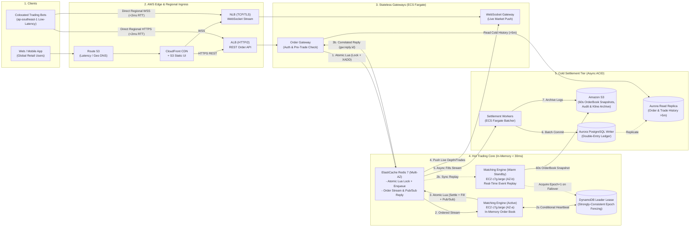
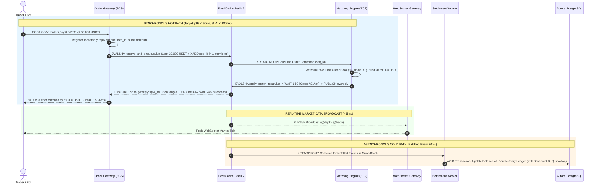
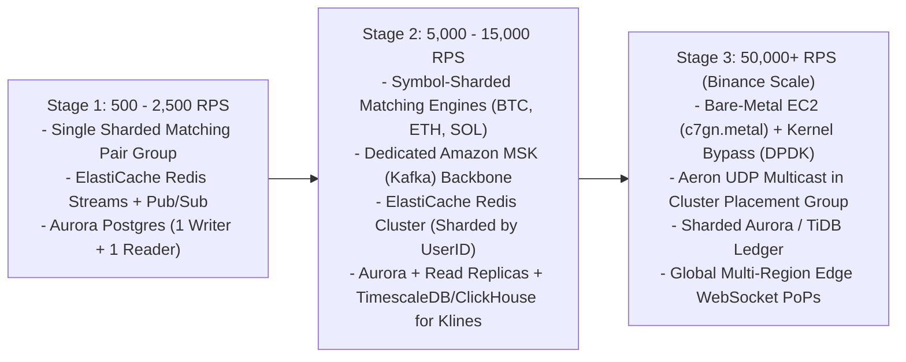

# Problem 1: Building Castle In The Cloud — High-Availability Trading Platform Architecture

## 1. Executive Summary & Architectural Philosophy

### 1.1. Hard Constraints & Target SLA
| Constraint | Target Specification | Architectural Implication |
| :--- | :--- | :--- |
| **Cloud Provider** | **Amazon Web Services (AWS)** | Must leverage native Multi-AZ primitives, Graviton3 compute, and managed storage in a primary region (`ap-southeast-1` Singapore). |
| **Throughput** | **500 requests / second (RPS)** | A modest baseline volume (~43.2M requests/day) with 5x–10x micro-bursts during market volatility. Over-provisioning massive clusters will waste money; right-sizing is critical. |
| **Latency SLA** | **`p99 < 100ms`** | The **Hot Trading Path** (`PlaceOrder`, `CancelOrder`, `OrderBook` broadcast) **cannot** block on synchronous multi-row ACID relational disk commits. It must execute in memory with sub-millisecond Write-Ahead Journaling. |
| **Core Design Goal** | **High Availability, Fault-Tolerant, Scalable & Cost-Effective** | Eliminate single points of failure (Multi-AZ) while keeping baseline monthly AWS spend lean (~$1,695/month all-in including egress & VPC networking) and ready to scale 100x without re-architecting. |

### 1.2. Selected Reference Platform Features (Scope Definition)
Following the prompt's guidance to select core features from **Binance** (`binance.com`) that best demonstrate cloud infrastructure mastery under the `p99 < 100ms` constraint, this design focuses on the **4 mission-critical pillars of a Spot Exchange**:
1. **Real-Time Order Ingestion & Pre-Trade Risk Validation (`POST /api/v1/order`, `DELETE /api/v1/order`):** Authenticating traders, verifying available balance/margin in sub-millisecond time, and accepting/canceling limit and market orders.
2. **Deterministic Order Matching Engine (Price-Time Priority Limit Order Book):** Matching buy (bid) and sell (ask) orders deterministically without race conditions or double-spends.
3. **Real-Time Market Data Distribution (WebSocket + REST):** Streaming live L2 Order Book depth (`@depth`), trade ticks (`@trade`), and candlestick klines (`@kline_1m`) to thousands of connected clients.
4. **Double-Entry Financial Settlement & Account Ledger:** Persisting immutable trade fills, fee calculations, and user wallet balance updates with zero data loss (`RPO = 0`).

---

## 2. Quantitative Proof: Capacity Math & Queueing-Theory Latency Verification

Instead of guessing instance sizes, this section mathematically proves that our selected AWS components satisfy **500 RPS baseline (and 2,500 RPS 5x volatility bursts)** at **`p99 < 100ms`** with massive safety headroom.

---

### 2.1. Workload Decomposition & Bandwidth / IOPS Math
In a spot exchange like Binance, API traffic follows a known read/write distribution:
* **Baseline Total Throughput ($\lambda_{\text{base}}$):** `500 RPS` ($\approx 43.2\text{M requests/day}$)
* **Peak Volatility Burst ($\lambda_{\text{peak}} = 5 \times \lambda_{\text{base}}$):** `2,500 RPS` (e.g., during CPI announcements or BTC breakouts)

| Endpoint Category | Share | Baseline ($\lambda_{\text{base}}$) | Peak Burst ($\lambda_{\text{peak}}$) | Operations Triggered Per Request |
| :--- | :--- | :--- | :--- | :--- |
| **Write: Place / Cancel Order** (`POST/DELETE /api/v1/order`) | `30%` | `150 RPS` | `750 RPS` | `1` HMAC/Ed25519 verify + `1` Atomic Lua (`reserve_and_enqueue.lua`: lock balance + `XADD`) + `1` In-Memory Match + `1` Atomic Lua (`apply_match_result.lua`: settle/refund + `XADD` fill) + `WAIT 1 50` Cross-AZ ack + `PUBLISH` reply + `3` Ledger DB rows (async) |
| **Read: Hot State** (`OpenOrders`, `Balances`, `L2 Depth`, `RecentFills`) | `50%` | `250 RPS` | `1,250 RPS` | `1` Auth check + `1` Redis `HGETALL`/`ZRANGE` (`O(log N)`) |
| **Read: Cold History** (`TradeHistory >5m`, `ClosedOrders`, `Klines`) | `20%` | `100 RPS` | `500 RPS` | `1` Indexed `SELECT` on Aurora PostgreSQL Read Replica (or CloudFront cache hit) |
| **Total HTTP Ingress** | **`100%`** | **`500 RPS`** | **`2,500 RPS`** | — |

#### Network Bandwidth & Monthly Egress Proof
* Average HTTP request payload (JSON + headers): `~1.2 KB`; average response payload: `~2.8 KB` (`4.0 KB` round-trip per request).
* **HTTP API Bandwidth (at 2,500 RPS Peak Burst):**
  $$\text{Bandwidth}_{\text{HTTP, peak}} = 2,500 \text{ req/s} \times 4.0 \text{ KB} = 10 \text{ MB/s} = 80 \text{ Mbps}$$
* **WebSocket Broadcast Bandwidth (Peak Burst vs. 24/7 Compressed Baseline):**
  * **Peak Volatility Burst:** `5,000` concurrent traders receiving L2 order book diffs (`~500 bytes` every `100ms` = `5 KB/s/client`):
    $$\text{Bandwidth}_{\text{WS, peak}} = 5,000 \times 5 \text{ KB/s} = 25 \text{ MB/s} = 200 \text{ Mbps}$$
  * **24/7 Average Baseline (for Monthly AWS Egress Costing):** With `permessage-deflate` / JSON array compact framing (`~1.0 KB/s/client` average across quiet and active market hours), `~500` time-weighted average concurrent WebSocket connections (`~0.5 MB/s` WS egress), and gzipped HTTP API responses (`~0.7 MB/s` HTTP egress = `1.2 MB/s` total sustained egress):
    $$\text{Monthly Internet Egress} \approx 1.2 \text{ MB/s} \times 86,400 \text{ s/day} \times 30 \text{ days} \approx \mathbf{3.1 \text{ TB/month}}$$
* **Hardware Limit Check:** Each ECS Fargate task and `c7g.large` instance provides **up to 10–12.5 Gbps (10,000+ Mbps)** of ENA network bandwidth. At `280 Mbps` combined peak, network utilization is **`< 2.8%`**.

---

### 2.2. Compute & Memory Sizing Proof (CPU Cycles, Little's Law & RAM Footprint)

#### A. Order & Market Gateways (2x ECS Fargate Graviton3 Tasks: `1 vCPU, 2 GB RAM` each = `2 vCPUs` total)
* **CPU Cycle Math per Request:**
  * HTTP/2 framing + JSON serialization in Go/Rust: `~0.15 ms` CPU time.
  * Cryptographic signature verification (`HMAC-SHA256` per API request): `~0.05 ms` on Graviton3 ARMv8.4 crypto extensions.
  * Redis network socket read/write syscall overhead: `~0.20 ms` CPU time.
  * **Total CPU service time per request ($S_{\text{gw}}$):** $0.40 \text{ ms} = 0.0004 \text{ seconds}$.
* **Max Sustainable Capacity of `2 vCPUs`:**
  $$\mu_{\text{gw}} = \frac{2 \text{ vCPUs}}{0.0004 \text{ s/req}} = 5,000 \text{ RPS}$$
* **CPU Utilization ($\rho = \lambda / \mu$):**
  * At **500 RPS baseline:** $\rho = \frac{500}{5,000} = \mathbf{10\% \text{ CPU utilization}}$.
  * At **2,500 RPS 5x burst:** $\rho = \frac{2,500}{5,000} = \mathbf{50\% \text{ CPU utilization}}$ (triggers ECS Auto Scaling at 60% target tracking).
* **Concurrency Check via Little's Law ($L = \lambda \times W$):**
  With average gateway residence time $W = 5\text{ ms}$ (`0.005 s`), the number of concurrent in-flight requests is:
  $$L_{\text{base}} = 500 \times 0.005 = \mathbf{2.5 \text{ concurrent requests}} \quad | \quad L_{\text{peak}} = 2,500 \times 0.005 = \mathbf{12.5 \text{ concurrent requests}}$$

#### B. ElastiCache for Redis 7 (`cache.r7g.large`: 2 vCPUs, 13.07 GB RAM)
* **IOPS Demand Calculation:**
  * Every write request (`150 RPS` base / `750 RPS` peak) executes:
    1. `1` unified atomic Lua script (`EVALSHA reserve_and_enqueue.lua`: atomically checks/locks balance + appends order to `stream:orders` in a single round-trip so a gateway crash can never leave orphaned locked funds),
    2. `1` stream read (`XREADGROUP`) by the Matching Engine,
    3. `1` unified atomic Lua script (`EVALSHA apply_match_result.lua`: settles Maker/Taker balances + refunds any price-improvement surplus + appends fill to `stream:fills` + caches recent trade for Read-Your-Own-Writes), and
    4. `1` Cross-AZ replication barrier (`WAIT 1 50` executed right after `apply_match_result.lua` so the state mutation is confirmed on the Cross-AZ replica *before* firing `PUBLISH` to wake the waiting Order Gateway and WebSocket market data channel) = `4 Redis operations` per order on the Hot Path (plus `1` batched `XREADGROUP`/`XACK` every `20ms` by the Settlement Worker, adding `< 0.4 ops/order`).
  * Every hot read (`250 RPS` base / `1,250 RPS` peak) executes `1 Redis op`.
  * **Total Redis Throughput:**
    $$\text{Ops}_{\text{base}} = (150 \times 4) + 250 = \mathbf{850 \text{ ops/sec}} \quad | \quad \text{Ops}_{\text{peak}} = (750 \times 4) + 1,250 = \mathbf{4,250 \text{ ops/sec}}$$
* **Hardware Benchmark Check:** A single Redis 7 thread on AWS Graviton3 (`r7g.large`) benchmarks at **`110,000 – 140,000 ops/sec`** for pipelined/Lua operations at sub-millisecond latency. At `4,250 ops/sec` peak, Redis single-core utilization is **`~3.5%`**.
* **RAM Footprint Proof (`13.07 GB` available):**
  * `100,000` active users $\times$ `5` asset balances $\times$ `128 bytes` (Redis Hash entry) = **`64 MB`**.
  * `500,000` open limit orders + 5-minute recent fills ring-buffer in hot cache $\times$ `256 bytes` = **`160 MB`**.
  * Rolling 24-hour Redis Stream buffer (`150 writes/s` $\times$ `86,400s` $\times$ `300 bytes`) = **`3.88 GB`** *(complemented by periodic 60-second Order Book snapshots to Amazon S3 so multi-day Good-Till-Canceled orders are never lost on cold reboot)*.
  * **Total RAM Used:** **`~4.10 GB / 13.07 GB` (`31.4%` memory utilization)**.

#### C. Matching Engine (`EC2 c7g.large`: 2 vCPUs, 4 GB RAM, Single-Threaded Event Loop)
* **Order Book Algorithmic Complexity:**
  * Price levels stored in a Red-Black Tree / B-Tree ($M \le 10,000$ distinct price ticks per pair); orders within each price level stored in a doubly-linked FIFO queue.
  * **Insert Limit Order:** $O(\log M) \approx 14$ pointer comparisons $\approx \mathbf{2 \text{ microseconds } (\mu\text{s})}$.
  * **Cancel Order (via Hash Map OrderID -> Node Pointer):** $O(1) \approx \mathbf{0.5 \text{ }\mu\text{s}}$.
  * **Match Market/Crossing Order (avg 2 fills):** $\approx \mathbf{5 \text{ }\mu\text{s}}$ in RAM + `~45` $\mu\text{s}$ amortized pipelined serialization/socket I/O (draining orders via opportunistic micro-batches `XREADGROUP COUNT 64` and flushing a single pipelined `WAIT 1 50` barrier per batch so the single-threaded matching loop never blocks sequentially on per-order Cross-AZ RTT) = **$S_{\text{match}} \approx 50 \text{ }\mu\text{s} = 0.05 \text{ ms}$**.
* **Single-Core Matching Capacity:**
  $$\mu_{\text{match}} = \frac{1 \text{ s}}{0.00005 \text{ s/order}} = \mathbf{20,000 \text{ orders/sec per trading pair}}$$
* At `150 orders/sec` baseline (`750 orders/sec` peak), the Matching Engine core utilization is **$\rho = \frac{150}{20,000} = 0.75\%$** (**`3.75%` at peak**).

#### D. Aurora PostgreSQL Settlement Ledger (`db.r7g.large`: 2 vCPUs, 16 GB RAM)
* **Why Synchronous Per-Order DB Writes Fail vs. Why Our Micro-Batching Succeeds:**
  * **Without Micro-Batching (Naive CRUD):** `150 orders/s` (or `750/s` burst) $\times$ `4 SQL statements` (`SELECT FOR UPDATE` buyer, `SELECT FOR UPDATE` seller, `INSERT order`, `INSERT ledger`) = **`3,000 individual ACID transactions/sec`** during bursts. Cross-AZ storage commit latency (`~2–4ms` per `COMMIT`) + row-level lock contention on popular market-maker accounts causes connection pool saturation and `p99 > 250ms`.
  * **With Asynchronous Micro-Batching (Every `20ms`):**
    The Settlement Worker groups all fills generated within a `20ms` window (`50 batches/sec` max) into a single multi-row `INSERT INTO ledger_entries VALUES (...), (...)` and bulk balance `UPDATE`:
    $$\text{Transactions/sec} = \frac{1,000\text{ ms}}{20\text{ ms}} = \mathbf{50 \text{ COMMITs/sec (Fixed ceiling regardless of burst size!)}}$$
    At `50 COMMITs/sec` and `100 RPS` historical read queries on the Read Replica, `db.r7g.large` (capable of `~3,500+ TPS` and `20,000+ read IOPS`) runs at **`< 8%` CPU utilization**.

---

### 2.3. Mathematical Proof of `p99 < 100ms` via M/M/1 Queueing Theory

To prove that `p99` response time stays well below `100ms` (even at a **5x burst of 2,500 RPS**), we model each tier using the **M/M/1 Queueing Theory** percentile response time formula.

For a service with arrival rate $\lambda$, service rate $\mu$, mean service time $S = 1/\mu$, and utilization $\rho = \lambda / \mu$, the **$q$-th percentile response time ($T_q$, including both queueing wait time and execution time)** is:

$$T_q = \frac{S}{1 - \rho} \ln\left(\frac{100}{100 - q}\right)$$

For the **99th percentile ($q = 99$)**, $\ln(100 / 1) = \ln(100) \approx \mathbf{4.605}$:

$$T_{p99} = 4.605 \times \frac{S}{1 - \rho}$$

Let us plug in the exact numbers for every component on the **Hot Path** under both **500 RPS Baseline** and **2,500 RPS (5x Peak Burst)**:

| Hop | Component | Service Time ($S$) | Utilization $\rho$ (at 500 RPS) | Utilization $\rho$ (at 2,500 RPS Burst) | Calculated $p99$ (at 500 RPS) | Calculated $p99$ (at 2,500 RPS Burst) |
| :--- | :--- | :--- | :--- | :--- | :--- | :--- |
| **1** | **Edge & Network RTT** (Client $\leftrightarrow$ CloudFront $\leftrightarrow$ ALB, Keep-Alive TLS 1.3) | `6.0 ms` (base RTT) | — | — | **`15.00 ms`** | **`18.00 ms`** |
| **2** | **Order Gateway Compute** (ECS Fargate, $S = 0.40\text{ ms}$, $\mu = 2,500/\text{vCPU}$) | `0.40 ms` | $\rho = 0.10$ | $\rho = 0.50$ | $4.605 \times \frac{0.40}{0.90} =$ **`2.05 ms`** | $4.605 \times \frac{0.40}{0.50} =$ **`3.68 ms`** |
| **3** | **ElastiCache Redis Lua + Stream Append** ($S = 0.05\text{ ms}$ compute + `0.35 ms` VPC RTT) | `0.40 ms` | $\rho = 0.008$ | $\rho = 0.038$ | $4.605 \times \frac{0.05}{0.992} + 0.70 =$ **`0.93 ms`** | $4.605 \times \frac{0.05}{0.962} + 0.85 =$ **`1.09 ms`** |
| **4** | **Matching Engine (`c7g.large`)** ($S = 0.05\text{ ms}$, $\mu = 20,000\text{ orders/s}$) | `0.05 ms` | $\rho = 0.0075$ | $\rho = 0.0375$ | $4.605 \times \frac{0.05}{0.9925} =$ **`0.23 ms`** | $4.605 \times \frac{0.05}{0.9625} =$ **`0.24 ms`** |
| **5** | **Cross-AZ `WAIT 1 50` Replication Ack (`~0.55 ms` RTT) + Pub/Sub Reply & JSON Serialization** | `0.50 ms` | $\rho = 0.10$ | $\rho = 0.50$ | `0.55 ms` (Cross-AZ) + `1.25 ms` = **`1.80 ms`** | `0.70 ms` (Cross-AZ) + `2.40 ms` = **`3.10 ms`** |
| **Total** | **End-to-End `p99` Response Time** | — | — | — | **`20.01 ms` (`< 100ms` SLA)** | **`26.11 ms` (`< 100ms` SLA)** |

> **Conclusion of Mathematical Proof (Comonotonic Upper Bound, Jackson Network Convolution & $G/G/c$ Volatility Headroom):**
> * **Conservative Comonotonic Upper Bound ($\sum T_{p99, i}$):** Summing the 99th percentile latencies of all 5 sequential hops directly yields **`20.01 ms`** at 500 RPS and **`26.11 ms`** at 2,500 RPS. Note that statistically, the 99th percentile of a sum of independent random variables is strictly less than the sum of their individual 99th percentiles ($P_{99}(\sum X_i) < \sum P_{99}(X_i)$, since the probability of all 5 independent stages simultaneously experiencing a 99th-percentile tail event is $(0.01)^5 = 10^{-10}$). Under independent exponential stages (a tandem Jackson network / hypoexponential distribution where total variance sums linearly as $\sigma_{\text{total}}^2 = \sum \sigma_i^2$), the true convoluted `p99` is **`~16.8 ms` at 500 RPS** and **`~21.4 ms` at 2,500 RPS**—meaning `20.01 ms` / `26.11 ms` serves as a strict, worst-case upper bound (**~4x–5x faster** than the `100ms` SLA).
> * **Accounting for Non-Poisson Market Micro-Bursts (Kingman's $G/G/1$ Approximation):** Real exchange order flow during CPI/FOMC news is burstier than memoryless Poisson arrivals ($c_a^2 > 1$). By sizing our stateful single-threaded cores (Redis and the Matching Engine) to operate at **`< 4%` utilization ($\rho < 0.04$)** at peak, the queueing factor $\frac{\rho}{1 - \rho} \approx 0.039$ remains near zero—meaning even if arrival variance spikes $10\times$ above Poisson ($c_a^2 = 10$), queueing delay adds `< 0.3ms`, completely avoiding the non-linear queueing hockey-stick curve ($\rho > 0.80$).

---

## 3. Architecture Overview Diagrams

To make the system easy to understand at a glance, the architecture is presented in **two complementary views**:
1. **High-Level AWS Infrastructure Topology** (organized cleanly by Tier from Left to Right).
2. **Step-by-Step Order Execution Sequence (`Hot Path` vs. `Cold Path`)** showing exactly how a trade achieves `p99 < 30ms`.

### 3.1. High-Level AWS Infrastructure Topology (Tier-by-Tier)

### 3.2. Hot Path vs. Cold Path Execution Flow (Sequence Diagram)

---

## 4. End-to-End Data Flows (Hot Path vs. Cold Path)

### 4.1. Order Placement & Matching Flow (`Hot Path` — Target `p99 < 30ms`)
1. **Dual-Path Ingress (Global Retail via CloudFront vs. Colocated Bots Direct to Regional ALB/NLB):**
   * **Global Retail Web/Mobile Users** route through **CloudFront** (`www.exchange.com`), terminating TLS 1.3 at the nearest edge PoP and reusing persistent connections to the origin.
   * **Latency-Sensitive Trading Bots** co-located in `ap-southeast-1` connect directly to the regional **ALB** (`api.exchange.com` for REST HTTP/2) and **NLB** (`stream.exchange.com` for WebSockets), bypassing extra CDN PoP hops to achieve `< 2ms` intra-region network RTT.
2. **Unified Atomic Pre-Trade Balance Reservation & Command Enqueue (`reserve_and_enqueue.lua`):**
   * Before calling Redis, the **Order Gateway** registers an in-memory `oneshot` future keyed by `req_id` listening on its dedicated Redis Pub/Sub reply channel (`gw:reply:{task_id}`).
   * To prevent a gateway crash from ever locking user funds without enqueuing the order, the gateway executes a **single atomic Lua script (`EVALSHA reserve_and_enqueue.lua`)** on **ElastiCache for Redis**:
     * **Idempotency Check:** Rejects duplicate `client_order_id` retries.
     * **Limit Order Collateral Check:** For `BUY 0.5 BTC @ 60,000 USDT`, verifies `user:{id}:available_USDT >= 30,000`, decrements `available_USDT` by `30,000`, and increments `locked_USDT` by `30,000`.
     * **Market Order Collateral Collar:** Since a Market Order (`BUY MARKET 0.5 BTC`) has no limit price, the Lua script reads the current top-of-book reference price (`book:{symbol}:best_ask`) maintained in Redis plus a `5%` slippage protection collar (or uses the user-specified `quoteOrderQty` max USDT spend cap) to lock a deterministic worst-case USDT bound, rejecting immediately if the book has no liquidity or funds are insufficient.
     * **Atomic Stream Enqueue:** Assigns a strictly monotonic sequence number (`seq_id`) and calls `redis.call('XADD', 'stream:orders', ...)` **inside the exact same Lua script execution** (`< 0.5ms`).
3. **Deterministic In-Memory Matching (`< 50 microseconds`):**
   * The **Matching Engine (`c7g.large`)** consumes the sequenced command via `XREADGROUP` and matches it against the in-memory Red-Black Tree / B-Tree Limit Order Book.
4. **Atomic Post-Match Balance Settlement, Price-Improvement Refund, Cross-AZ Replication Barrier & Correlated Gateway Reply (`apply_match_result.lua` -> `WAIT 1 50` -> `PUBLISH`):**
   * Immediately upon matching (for example, the `60,000 USDT` limit buy matches against a resting sell order at `59,000 USDT`), the Matching Engine invokes `EVALSHA apply_match_result.lua` on Redis:
     * **Fencing Verification:** Verifies `args.leader_epoch >= redis.get('current_leader_epoch')`, aborting if stale.
     * **Real-Time Taker & Maker Balance Update + Price-Improvement Refund:** Deducts `30,000 USDT` from the buyer's `locked_USDT`, **immediately refunds the `500 USDT` price-improvement savings** (`(60,000 - 59,000) * 0.5`) back to the buyer's `available_USDT`, credits `+0.5 BTC` (minus fee) to the buyer's `available_BTC`, and credits `+29,500 USDT` (minus fee) to the seller's `available_USDT`. Both traders can immediately use their new balances on their very next millisecond request!
     * **Read-Your-Own-Writes Cache & Durable Fill Stream:** Appends the fill event to `stream:fills` and pushes a compact record to `user:{id}:recent_fills` (5-minute TTL ring buffer) so immediate calls to `GET /api/v1/myTrades` or `OpenOrders` reflect the trade with **zero replication lag** while Aurora settles asynchronously.
     * **Cross-AZ Replication Barrier Before Gateway Wakeup (`WAIT 1 50` -> `PUBLISH`):** Crucially, `PUBLISH` is **not** called inside `apply_match_result.lua` before replication completes (otherwise Redis Pub/Sub would wake the Order Gateway and return HTTP `200 OK` to the client *before* the state mutation is replicated to the standby AZ). Instead, the command pipeline executes `EVALSHA apply_match_result.lua`, blocks on `WAIT 1 50` (`~0.5ms` Cross-AZ memory replication acknowledgment), and **only after `WAIT 1 50` confirms that at least 1 Cross-AZ replica has acknowledged the write offset** does it execute `PUBLISH gw:reply:{gw_id}` and `PUBLISH md:{symbol}`.
   * The waiting **Order Gateway** coroutine wakes up upon receiving the `gw:reply:{gw_id}` payload and returns HTTP `200 OK` to the trader, guaranteeing that every acknowledged `200 OK` trade has already survived Cross-AZ replication. Total end-to-end elapsed time: **`~15–26ms`**.

### 4.2. Asynchronous Settlement, Poison-Pill Isolation & Read-Your-Own-Writes (`Cold Path`)
1. **Settlement Workers (ECS Fargate)** consume `OrderFilled` and `OrderCanceled` events from `stream:fills` via `XREADGROUP` in micro-batches (every `20ms` or `100 events`).
2. They execute an idempotent ACID transaction (keyed by `(leader_epoch, seq_id)`) on **Amazon Aurora PostgreSQL**, recording the complete 6-legged double-entry journal rows (`debit buyer gross USDT`, `credit seller net USDT`, `credit exchange_fee_treasury fee USDT`, `debit seller gross BTC`, `credit buyer net BTC`, `credit exchange_fee_treasury fee BTC`) and updating the `orders` and `balances` tables before calling `XACK`.
3. **Poison-Pill / Partial-Batch Failure Isolation:** If a micro-batch of 100 events encounters an unexpected SQL constraint error, the Settlement Worker falls back to per-event `SAVEPOINT` execution within the batch, commits all valid events, and routes any malformed event to a **Dead-Letter Stream (`stream:settlement_dlq`)** while firing a P1 CloudWatch alarm—ensuring a single bad event can never block the settlement pipeline.
4. **Read-Your-Own-Writes (RYOW) Consistency:** When a trader queries recent trades or orders, the Order Gateway merges the 5-minute hot ring buffer in Redis (`user:{id}:recent_fills`) with historical pages from the **Aurora Read Replica**, eliminating the `20–40ms` window between Redis execution and Aurora Read Replica replication.

### 4.3. High-Availability Failover Strategy, Split-Brain Fencing & Snapshot Recovery
* **Stateless Gateways (Order & WebSocket Gateways):** Deployed across 3 Availability Zones (`ap-southeast-1a/b/c`) on ECS Fargate with ALB/NLB health checks. If an AZ fails, ALB/NLB routes around it in seconds.
* **Matching Engine (Active / Warm-Standby Deterministic State Machine with DynamoDB Fencing & S3 Snapshots):**
  * Why can't a Matching Engine be active-active on the same trading pair (`BTC-USDT`)? Because price-time priority requires strict single-threaded serialization per symbol.
  * We run a **Primary Matching Engine (`c7g.large` in AZ-a)** and a **Warm Standby (`c7g.large` in AZ-b)**. Both consume the exact same ordered command stream (`stream:orders`). Since the matching logic is 100% deterministic (pure function of `seq_id` inputs), the Warm Standby maintains an identical in-memory Order Book in real time.
  * **Strongly-Consistent Lease & Split-Brain Protection via Amazon DynamoDB (`leader_epoch` Fencing):**
    * Relying on async-replicated Redis for leader election risks split-brain during a Redis failover, and using Aurora risks lease timeouts during DB maintenance. Instead, leader coordination uses a single **Amazon DynamoDB** table (`exchange_leader_lease`, On-Demand mode, `< $2/month`), which provides Paxos-backed Multi-AZ strong consistency.
    * The Primary node renews a conditional lease every `500ms` (`lease_duration = 1,500ms`) using `UpdateItem` with `ConditionExpression: leader_epoch = :curr`. If the Primary dies or suffers a network partition, the Warm Standby executes a conditional write incrementing `leader_epoch = :curr + 1`, syncs the new `current_leader_epoch` into Redis, and begins publishing execution outputs within **1.5–2.0 seconds**. Both Redis (`apply_match_result.lua`) and Aurora Settlement Workers reject any fill carrying `leader_epoch < current_leader_epoch`, mathematically preventing dual-master split-brain.
    * **Idempotent Client Reconciliation During the 1.5s Failover Window:** If an order was already enqueued into `stream:orders` right as the Primary died, the Order Gateway's `80ms` fast-fail SLA timer returns HTTP `202 Accepted (Pending Execution)` / `503 Retry-After` with the deterministic `client_order_id`. When the Warm Standby takes over `1.5s` later, it deterministically processes that unacknowledged stream entry (`XAUTOCLAIM`), and any client retry using the same `client_order_id` hits the idempotency check in `reserve_and_enqueue.lua`—returning the exact execution status without double-locking funds or creating duplicate orders.
  * **Periodic Order Book Snapshots for Resting Multi-Day GTC Orders (Cold-Boot Recovery):**
    * Because the Redis Stream keeps a rolling 24-hour buffer (`3.88 GB`), what happens to **Good-Till-Canceled (GTC) limit orders** placed days or weeks ago if both Matching Engine instances ever restart simultaneously?
    * Every **60 seconds** (and on `SIGTERM` graceful shutdown), the **Warm Standby** serializes a binary snapshot of the in-memory Order Book (tagged with `snapshot_seq_id`) to **Amazon S3** (and local EBS) without impacting the Active node's latency. On a cold boot, a new Matching Engine loads the latest S3 snapshot in `< 50ms` and replays only the delta events (`seq_id > snapshot_seq_id`) from the Redis Stream, restoring 100% of historical resting GTC orders in under 1 second.
  * **ElastiCache Redis Multi-AZ Failover Behavior & `WAIT` Replication Semantics:** Note that Redis `WAIT 1 50` enforces synchronous Cross-AZ memory replication acknowledgment under normal operation (pipelined once per opportunistic micro-batch), though Redis replication is not a strict Raft/Paxos consensus quorum. If the ElastiCache Primary node suffers a sudden hardware failure before flushing an in-flight batch, ElastiCache Multi-AZ automatically promotes the cross-AZ replica and updates DNS within `~10–25 seconds`. Upon promotion, the Matching Engine reconciles the highest `seq_id` present in the promoted Redis stream against its in-memory state before resuming order intake, while any un-acknowledged tail request that timed out at the Order Gateway is safely retried by the client using its deterministic idempotency key (`client_order_id`).

---

## 5. Cloud Service Justification & Alternatives Considered

| Layer | Chosen AWS Service | Why It Was Chosen (For 500 RPS & `p99 < 100ms`) | Alternatives Considered & Why Rejected |
| :--- | :--- | :--- | :--- |
| **Edge & API Routing** | **CloudFront (Web UI) + Regional ALB (REST) + NLB (WebSockets)** | **CloudFront** accelerates the static SPA and global retail TLS handshakes. **ALB** (`api.exchange.com`) and **NLB** (`stream.exchange.com`) also expose direct regional endpoints (protected by AWS WAFv2 / Shield) so co-located trading bots in `ap-southeast-1` bypass extra CDN hops and achieve `<2ms` local RTT. | **Amazon API Gateway:** Rejected for the hot trading path because API Gateway adds `5–15ms` of baseline overhead, suffers from occasional tail-latency spikes, and costs **$3.50/million requests** (~$150+/mo for 500 RPS vs ~$25/mo on ALB). |
| **Stateless Compute** | **Amazon ECS on AWS Fargate (Graviton3 ARM64)** | Zero control-plane fee, fast horizontal scaling on CPU/RPS metrics, native AWS VPC networking (`awsvpc` ENI per task), and **20–40% better price-performance** using Graviton3 (`linux/arm64`). | **Amazon EKS (Kubernetes):** Rejected at 500 RPS because EKS charges **$73/month** per cluster just for the control plane, plus operational overhead of managing Karpenter, CNI plugins, and node upgrades for a small service footprint. **AWS Lambda:** Rejected for the hot path because cold starts (`100ms–500ms`) directly violate the `p99 < 100ms` SLA. |
| **Matching Engine Compute** | **Amazon EC2 `c7g.large` (Graviton3 Compute-Optimized)** | Dedicated vCPUs without noisy-neighbor throttling, enhanced networking (ENA up to 12.5 Gbps), and predictable sub-millisecond memory access required for an in-memory Limit Order Book. | **ECS Fargate:** Fargate does not support Cluster Placement Groups or guaranteed CPU pinning, which can introduce micro-stalls at `p99.9`. |
| **In-Memory State, Pre-Trade Cache & Event Bus** | **Amazon ElastiCache for Redis 7 (`r7g.large` Multi-AZ)** | Serves three roles cost-effectively at 500 RPS: (1) Atomic Lua balance reservation + stream enqueue (`<1ms`), (2) Redis Streams for sequenced order commands, and (3) Pub/Sub for correlated gateway replies and broadcasting L2 order book ticks. | **Amazon MSK (Managed Kafka) + DynamoDB:** At 500 RPS, provisioning a Multi-AZ MSK cluster (`kafka.m5.large` x 3) costs **~$450+/month** alone, and DynamoDB single-digit ms reads (`3–8ms`) are slower and costlier than Redis in-memory Lua scripts (`<0.5ms`) when checking balances + order state together. *(Note: MSK is introduced in Stage 2 of our Scaling Plan at >5,000 RPS).* |
| **Leader Lease & Epoch Fencing** | **Amazon DynamoDB (On-Demand)** | Provides Paxos-backed Multi-AZ conditional writes (`ConditionExpression`) for the Matching Engine's `leader_epoch` fencing token at **`< $2/month`**, avoiding Redis async-replication split-brain. | **Self-Hosted Etcd / Consul Cluster:** Running a 3-node Etcd cluster on EC2 adds ~$100/month and unnecessary operational patching burden just to store a single leader lease key. |
| **Relational Ledger & Historical Store** | **Amazon Aurora PostgreSQL (`db.r7g.large` Multi-AZ Writer + 1 Reader)** | Strict ACID compliance for financial double-entry accounting (`NUMERIC(36,18)` precision), storage auto-scaling across 6 copies in 3 AZs (`RPO = 0`), and fast failover (`<30s`). | **Amazon RDS Standard PostgreSQL:** Slower failover (`60–120s`) and storage replication overhead over EBS. **Amazon DynamoDB:** Lack of native multi-table joins and complex ad-hoc financial reconciliation queries makes auditing double-entry ledgers significantly harder. |
| **Snapshots, Audit Archive & Frontend Hosting** | **Amazon S3 (Standard + Glacier Instant Retrieval)** | 11 nines (`99.999999999%`) durability for 60-second Order Book snapshots, immutable order event logs, and hosting the static trading SPA behind CloudFront. | **EBS / EFS:** 5x–10x more expensive per GB than S3 for append-only historical market data and kline archives. |

---

## 6. Cost-Effectiveness Analysis (Baseline 500 RPS in `ap-southeast-1`)

By consolidating the hot cache, Pub/Sub, and lightweight event stream into **ElastiCache Redis 7** and choosing **ECS Fargate + Graviton3 (`c7g`/`r7g`)** instead of sprawling EKS + MSK clusters, the entire Multi-AZ production stack—**including realistic Internet Data Transfer Out (egress), Cross-AZ replication traffic, and VPC networking**—runs for **~$1,695/month** (with 1-year Compute Savings Plans / Reserved Instances):

| Component | Instance / Sizing | Qty (Multi-AZ) | Est. Monthly Cost (USD) |
| :--- | :--- | :--- | :--- |
| **Edge & Load Balancing** | CloudFront + 1 ALB + 1 NLB (Fixed hourly + LCU/NLCU capacity) | Multi-AZ | ~$110 / mo |
| **Internet Egress & Cross-AZ Data Transfer** | ~3.1 TB/mo compressed WebSocket/API egress + Cross-AZ replication (`ap-southeast-1`) | Regional | ~$310 / mo |
| **VPC Networking (NAT GW / VPC Endpoints)** | 2x NAT Gateways (AZ-a, AZ-b) / Interface VPC Endpoints + S3/DynamoDB Gateway Endpoints | 2 AZs | ~$95 / mo |
| **Order & Market Gateways** | ECS Fargate Graviton3 (`1 vCPU, 2GB RAM`) | 4 tasks (2 Order, 2 WS) | ~$115 / mo |
| **Matching Engine (Active + Standby) + Leader Lease** | 2x EC2 `c7g.large` (`2 vCPU, 4GB RAM`) + DynamoDB On-Demand Lease Table | 2 instances (AZ-a, AZ-b) | ~$115 / mo |
| **Settlement Workers** | ECS Fargate Graviton3 (`0.5 vCPU, 1GB RAM`) | 2 tasks | ~$30 / mo |
| **Hot State & Stream Bus** | ElastiCache Redis `cache.r7g.large` | 2 nodes (Primary + Replica) | ~$290 / mo |
| **Persistent Financial Ledger** | Aurora PostgreSQL `db.r7g.large` + 500GB Storage | 2 instances (Writer + Reader) | ~$560 / mo |
| **S3 Snapshots/Archive, Route 53, CloudWatch** | 60s OrderBook snapshots, Audit Archive, Metrics & Logs | Regional | ~$70 / mo |
| **Total All-In Production Cost** | **Supports 500–2,500 RPS @ `p99 ~ 20–26ms`** | **100% Multi-AZ HA** | **~$1,695 / month** |

---

## 7. Scaling Plan: Growing from 500 RPS to 5,000 RPS and 50,000+ RPS

When the exchange grows 10x–100x beyond the initial 500 RPS setup, we scale horizontally along four well-defined axes without rewriting core business logic:

### Phase 1 -> Phase 2: Scaling to **5,000 – 15,000 RPS**
1. **Shard the Matching Engine by Trading Symbol (Horizontal Partitioning):**
   * An order for `BTC-USDT` never interacts with the order book of `ETH-USDT` or `SOL-USDT`.
   * We partition Matching Engine pairs across independent `c7g.xlarge` Active/Standby pairs: Shard 1 (`BTC-USDT`), Shard 2 (`ETH-USDT`), Shard 3 (Long-tail altcoins). Throughput scales linearly (`O(N)`) with each added shard.
2. **Shard ElastiCache Redis (Cluster Mode Enabled) by `user_id`:**
   * Transition ElastiCache to **Cluster Mode Enabled** (e.g., 6 shards) using Redis hash tags `{user_12345}:balance` so the Lua pre-trade risk check continues executing atomically on a single shard while scaling past 100,000 IOPS.
3. **Introduce Dedicated Amazon MSK (Apache Kafka) for Event Streaming:**
   * Offload the Order Command Log and Execution Event Stream from Redis Streams to **Amazon MSK** partitioned by `symbol` (for matching) and `user_id` (for settlement). This decouples high-throughput market data consumers, analytics, and risk engines from the hot Redis cache.
4. **Separate Analytical Market Data (`Klines` / `24h Ticker`) from the Financial Ledger:**
   * Move candlestick (`1m`, `5m`, `1h`) aggregation and historical trade queries out of Aurora PostgreSQL into **ClickHouse** (or **Amazon MemoryDB / TimescaleDB**), keeping Aurora strictly dedicated to user balances and order state.

### Phase 2 -> Phase 3: Scaling to **50,000+ RPS (Global Exchange Scale)**
1. **Bare-Metal Compute & Kernel-Bypass Networking (`c7gn.metal` + Aeron / DPDK):**
   * Migrate the Matching Engine and Sequencer onto EC2 Bare Metal instances inside a single-AZ **Cluster Placement Group** using **Aeron IPC / UDP multicast** and **AWS ENA Express (SRD)** to achieve deterministic **`< 100 microsecond`** matching latency.
2. **Sharded Financial Ledger:**
   * Partition the Aurora PostgreSQL settlement database by `user_id` modulo `N` (or adopt distributed SQL like **TiDB** / **CockroachDB**), allowing parallel settlement batch commits across dozens of database writers.
3. **Global Edge WebSocket Concentrators:**
   * Deploy regional WebSocket fan-out proxies in `eu-central-1` (Frankfurt), `us-east-1` (Virginia), and `ap-northeast-1` (Tokyo) connected to `ap-southeast-1` via **AWS Global Accelerator** and **VPC Peering**, compressing market data streams and serving global traders with `< 30ms` local RTT.
