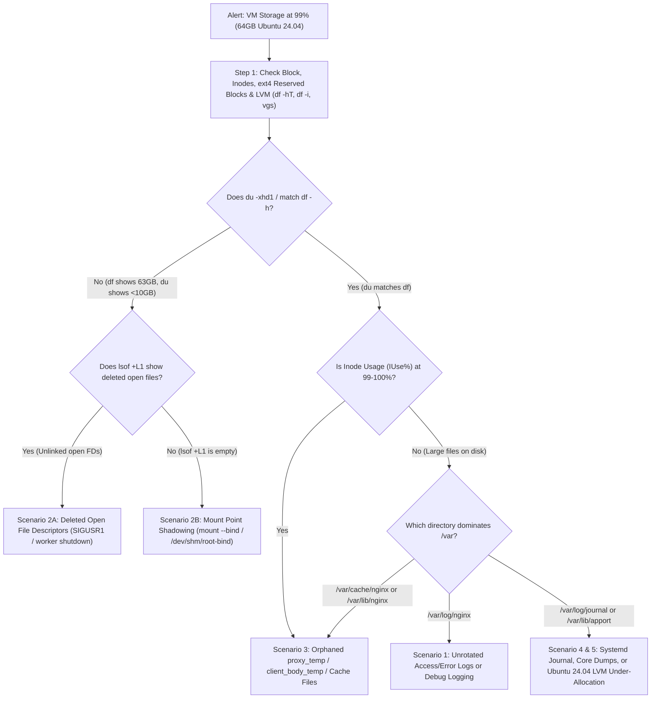

# Problem 2: Diagnose Me Doctor — Production Storage Exhaustion Runbook

## 1. Executive Summary & Context

* **System Under Investigation:** Cloud Virtual Machine running **Ubuntu 24.04 LTS** with **64 GB** block storage.
* **Workload:** Dedicated single-purpose **NGINX Load Balancer / Reverse Proxy** routing traffic to upstream services.
* **Alert Condition:** Disk utilization consistently pinned at **99%** (~63.3 GB used, < 700 MB free).

### Why 99% Disk on a Dedicated NGINX Node Is an Immediate P1 Risk
Even though NGINX primarily routes network traffic in memory, hitting 99–100% disk utilization (or 100% inode exhaustion) on Ubuntu 24.04 triggers severe cascading failures:
1. **Payload Buffering Failures (`500` / `502` Errors):** When upstream responses or client request bodies (`client_body_temp_path`, `proxy_temp_path`) exceed in-memory buffer sizes (`proxy_buffer_size`, `proxy_buffers`), NGINX spills temporary files to `/var/lib/nginx/` or `/var/cache/nginx/`. If disk space or inodes hit 0, NGINX fails to write buffer files and drops active requests with `500 Internal Server Error`.
2. **Configuration Reload & Management Lockout (`nginx -t` / `systemctl reload nginx`):** NGINX cannot write PID files, temporary test configs, or error logs; SSH/SSM sessions may fail to allocate temporary files in `/tmp` or `/var/log/auth.log`.
3. **Blind Observability:** Both NGINX (`access.log`, `error.log`) and `systemd-journald` stop recording events, leaving engineers blind during an incident.

---

## 2. Step-by-Step Diagnostic Methodology (Triage in < 3 Minutes)

Before deleting any files, we execute a read-only diagnostic sequence to determine **what** is consuming the 64 GB and **whether** space is held by visible files on disk or unlinked open file descriptors in the Linux kernel.



### Step 1: Verify Block Usage, `ext4` Reserved Blocks, Inode Saturation, and LVM Partitioning
Ubuntu 24.04 Server installer defaults to allocating only a portion of the volume to the root Logical Volume (`ubuntu-lv`) unless configured otherwise, or could be out of inodes (`df -i`). Additionally, on `ext4` filesystems, **5% of disk blocks (~3.2 GB on a 64 GB disk) are reserved exclusively for `root` (`uid=0`)**—meaning non-root processes like NGINX workers (`www-data`) hit `ENOSPC (28: No space left on device)` and `Avail = 0` as soon as physical usage reaches **95%**, while `root` (`sudo`) still has reserved headroom to execute recovery commands:
```bash
# Check human-readable block usage and filesystem types
df -hT

# Check inode exhaustion (millions of tiny NGINX temp/cache files can exhaust inodes at <10GB block usage)
df -i

# Check if the 64GB disk has unallocated partition or LVM Volume Group space (Ubuntu 24.04 installer quirk)
sudo vgs && sudo lvs && lsblk
```

### Step 2: Compare Filesystem Tree Usage (`du`) Against Kernel Block Allocation (`df`)
> **Note:** All `sort` commands below pass `-T /dev/shm` (RAM-backed `tmpfs`) so `sort` never fails with `cannot create temporary file in '/tmp': No space left on device` when `/` is 100% full.

```bash
# Inspect top-level directories on the root filesystem (-x stays on one filesystem, avoiding /proc, /sys, /dev)
sudo du -xh --max-depth=2 / 2>/dev/null | sort -T /dev/shm -hr | head -n 20
```
* **Critical Branch Point:**
  * If `df -h /` reports **63 GB used**, while `sudo du -xhd1 /` totals only **5 GB**, the missing **58 GB** is either:
    1. Held in the kernel by **open file descriptors pointing to deleted files (`(deleted)`)**, OR
    2. Hidden beneath a mounted directory (**Mount Point Shadowing**, e.g., 58 GB of files written to `/var/log` on the root disk before a separate volume was mounted over `/var/log`).
  * If `du` also reports **~63 GB**, the space is consumed by actual visible files on disk (typically under `/var/log`, `/var/cache/nginx`, `/var/lib/nginx`, or `/var/lib/apport`).

### Step 3: Check for Deleted Open File Descriptors (`lsof`) & Mount Point Shadowing
```bash
# 3A. List all unlinked files still held open by running processes (sorted by size)
sudo lsof -nP +L1 | sort -T /dev/shm -k7 -nr | head -n 15

# Or inspect NGINX worker file descriptors directly via /proc without spawning heavy lsof scans:
sudo ls -l /proc/$(pgrep -o -f "nginx: worker")/fd | grep "(deleted)"

# 3B. If du < df AND lsof +L1 is empty, check for files hidden under sub-mounts (Mount Point Shadowing):
sudo mkdir -p /dev/shm/root-bind
sudo mount --bind / /dev/shm/root-bind
sudo du -xh --max-depth=2 /dev/shm/root-bind 2>/dev/null | sort -T /dev/shm -hr | head -n 15
sudo umount /dev/shm/root-bind && sudo rmdir /dev/shm/root-bind
```

### Step 4: Locate Largest Files & Highest File-Count Directories (Without Fork-Storms)
```bash
# Top 15 largest individual files on the root filesystem (>50MB)
sudo find / -xdev -type f -size +50M -exec ls -lh {} + 2>/dev/null | sort -T /dev/shm -k5 -hr | head -n 15

# If df -i showed high inode usage, find directories with the highest file count in a single pass
# (avoids spawning subshells per directory and uses /dev/shm for sort temporary buffers):
sudo find /var -xdev -printf '%h\n' 2>/dev/null | sort -T /dev/shm | uniq -c | sort -T /dev/shm -nr | head -n 10
```

---

## 3. Expected Root Causes, Impacts & Recovery Steps

While the prompt notes *"Provide steps to troubleshoot two production issues"* alongside the single NGINX 99% storage scenario, in production a 99% disk alert on an NGINX VM almost always stems from **two distinct failure classes** (plus three secondary operational scenarios). Below is the complete breakdown of all **5 expected root causes**, starting with the two primary production issues:

---

### Primary Issue A (Scenario 1): Unbounded NGINX Access/Error Logs & Broken `logrotate`
#### Root Cause
1. High traffic volume combined with verbose logging (or `error_log /var/log/nginx/error.log debug;` left enabled after a previous debugging session) generates tens of gigabytes of logs per day.
2. On Ubuntu 24.04, `logrotate` runs via a systemd timer (`logrotate.timer` -> `logrotate.service`) once daily by default. If traffic spikes (e.g., an L7 DDoS attack or upstream `502` storm generating massive error logs), `/var/log/nginx/access.log` and `error.log` can fill 64 GB **between daily timer runs**.
3. Alternatively, `/etc/logrotate.d/nginx` is misconfigured (e.g., missing `maxsize`, failing `postrotate` script due to permission mismatches on `/run/nginx.pid`, or lacking `compress`).

#### Impact
* Once disk reaches 100%, NGINX stops writing access and error logs, breaking security auditing and real-time troubleshooting.
* System services (`systemd-journald`, `syslog`, `sshd`) fail to write logs or state files, degrading host manageability.

#### Safe Recovery Steps (Zero Downtime)
> **Warning:** **NEVER** run `rm /var/log/nginx/access.log` while NGINX is running! Deleting an active log file does not free disk blocks until NGINX closes its file descriptor.

1. **Immediate Mitigation (Truncate in-place to reclaim space instantly without restarting NGINX):**
   ```bash
   # Truncate the file inode to 0 bytes in-place (reclaims disk space immediately with zero traffic drop
   # and requires 0 free blocks/inodes, unlike sed -i or logrotate which fail at 100% ENOSPC)
   sudo truncate -s 0 /var/log/nginx/access.log
   sudo truncate -s 0 /var/log/nginx/error.log
   # (Or pure shell built-in if even external binaries fail: sudo sh -c ': > /var/log/nginx/access.log')

   # Delete old rotated/compressed archives if needed
   sudo find /var/log/nginx/ -type f -name "*.gz" -mtime +3 -delete
   ```
2. **Disable `debug` log level if active:**
   Check `/etc/nginx/nginx.conf` and `/etc/nginx/conf.d/*.conf` for `error_log ... debug;`, change to `warn` or `error`, and run `sudo nginx -t && sudo systemctl reload nginx`.
3. **Permanent Fix (Harden `/etc/logrotate.d/nginx` + Override Ubuntu 24.04 `logrotate.timer` to Hourly):**
   Update `/etc/logrotate.d/nginx` to combine `daily` time-based retention (`rotate 14` = 14 days during normal traffic) with `maxsize 500M` size-triggered rotation (checked hourly via systemd timer) and immediate compression (`nodelaycompress` after `USR1` so a multi-GB spike file is compressed right away rather than sitting uncompressed as `.log.1`):
   ```text
   /var/log/nginx/*.log {
       daily
       maxsize 500M
       missingok
       rotate 14
       maxage 14
       compress
       nodelaycompress
       notifempty
       create 0640 www-data adm
       sharedscripts
       prerotate
           if [ -d /etc/logrotate.d/httpd-prerotate ]; then
               run-parts /etc/logrotate.d/httpd-prerotate
           fi
       endscript
       postrotate
           if [ -f /run/nginx.pid ]; then
               kill -USR1 $(cat /run/nginx.pid)
               sleep 1
           fi
       endscript
   }
   ```
   > **Why `daily` + `maxsize 500M` + Hourly Timer + `sleep 1` with `nodelaycompress`:**
   > * If you set `hourly` + `rotate 14`, `logrotate` unconditionally rotates every hour even when logs are tiny, deleting all logs older than **14 hours**! By setting `daily` + `maxsize 500M` and overriding `logrotate.timer` to run **hourly**, `logrotate` only rotates mid-day if a log file actually exceeds `500M`, while preserving up to 14 days of history during normal traffic.
   > * **Why `sleep 1` is critical when using `nodelaycompress`:** In Linux, `kill -USR1` is **asynchronous**—when `kill` returns, the NGINX master process has only received the signal and forwarded it to worker processes, which take a few milliseconds to reopen new file descriptors and close `.log.1`. Adding `sleep 1` inside `postrotate` guarantees all workers have flushed and closed `.log.1` before `logrotate` invokes `gzip`, preventing both log-line loss and leaving a multi-GB uncompressed `.log.1` file sitting on disk (which happens with `delaycompress`).
   > * Also note why **Step 1 (`truncate -s 0`) MUST be executed before `logrotate -f`** when disk is at 99%: running `gzip` on a 20 GB log file or writing `/var/lib/logrotate/status.tmp` when `< 700 MB` is free will fail with `No space left on device`.

   ```bash
   # Override systemd logrotate.timer from daily to hourly on Ubuntu 24.04
   sudo mkdir -p /etc/systemd/system/logrotate.timer.d
   printf "[Timer]\nOnCalendar=\nOnCalendar=hourly\nAccuracySec=1m\n" | sudo tee /etc/systemd/system/logrotate.timer.d/hourly.conf
   sudo systemctl daemon-reload
   sudo systemctl restart logrotate.timer

   # Dry-run validation and force immediate rotation test (after Step 1 freed space)
   sudo logrotate -d /etc/logrotate.d/nginx
   sudo logrotate -f /etc/logrotate.d/nginx
   ```

---

### Primary Issue B (Scenario 2): Deleted Open File Descriptors (`lsof +L1`) or Mount Point Shadowing (`df` vs `du` Discrepancy)
#### Root Cause
* **Case 2A (Unlinked Open File Descriptors):** Either an engineer previously ran `rm -f /var/log/nginx/access.log` to free space, **or** `logrotate` rotated/deleted the old log file without executing `kill -USR1 $(cat /run/nginx.pid)` (or `nginx` worker processes hung in `"worker process is shutting down"` state after a config reload due to long-lived WebSocket/HTTP streaming connections). In Linux (`ext4`/`XFS`), `rm` only removes the directory entry (`unlink()`). The kernel refuses to reclaim the underlying data blocks until the open file descriptor (`fd`) count drops to `0`.
* **Case 2B (Mount Point Shadowing):** If `df -h /` shows 63 GB used, `du -xhd1 /` shows 5 GB, **and `lsof +L1` is empty**, then large files were written to a directory on the root filesystem (such as `/var/log` or `/var/cache/nginx`) *before* another volume or `tmpfs` was mounted over that path, hiding the underlying files from `du`.

#### Impact
* `df -h` remains stuck at **99%** even though `/var/log/nginx/` looks completely empty (`ls -lh` and `du -sh` show 0 bytes).
* Confusion during incident response often leads engineers to reboot the whole VM unnecessarily, causing a preventable load-balancer outage.

#### Safe Recovery Steps (Zero Downtime)
1. **Confirm the unlinked file descriptors:**
   ```bash
   sudo lsof -nP +L1 | grep nginx
   # Example output:
   # nginx 1422 www-data 4w REG 259,1 54892134400 0 131079 /var/log/nginx/access.log.1 (deleted)
   ```
2. **Reopen NGINX log files gracefully (`SIGUSR1`):**
   Sending `USR1` instructs the NGINX master and worker processes to close their current log file descriptors and open new ones—**without dropping a single active client connection**:
   ```bash
   sudo kill -USR1 $(cat /run/nginx.pid)
   ```
3. **Handle stuck `"worker process is shutting down"` processes (if any):**
   If old worker processes from a previous reload are still holding deleted file descriptors because of stalled upstream/WebSocket connections:
   ```bash
   ps aux | grep "worker process is shutting down"
   # If the open FD is an NGINX log file (opened with O_APPEND), truncate via /proc/<pid>/fd/<fd_num>:
   sudo truncate -s 0 /proc/<stuck_worker_pid>/fd/<fd_num>
   # (Note: Only use truncate on FDs opened with O_APPEND; for non-O_APPEND temp files, terminate the
   # hung shutting-down worker via kill -QUIT <pid> so the kernel does not create a sparse file hole.)
   # Permanently prevent hung workers by setting worker_shutdown_timeout 30s; in /etc/nginx/nginx.conf.
   ```
4. **If `lsof +L1` was empty (Mount Point Shadowing recovery):**
   ```bash
   sudo mkdir -p /dev/shm/root-bind && sudo mount --bind / /dev/shm/root-bind
   # Inspect and delete the shadowed files inside the underlying root directory (e.g. /dev/shm/root-bind/var/log/nginx/*)
   sudo rm -rf /dev/shm/root-bind/var/log/nginx/*.old
   sudo umount /dev/shm/root-bind && sudo rmdir /dev/shm/root-bind
   ```

---

### Scenario 3: Unbounded NGINX Proxy Cache / Temp File Accumulation (`proxy_temp_path`, `client_body_in_file_only` & `proxy_cache_path`)
#### Root Cause
1. **Unbounded Proxy Cache:** `proxy_cache_path` is enabled in NGINX without a strict `max_size` parameter (or `max_size` is set larger than available disk), or the NGINX cache manager process crashed.
2. **Orphaned Proxy / Client Body Temp Files (`/var/lib/nginx/proxy/`, `/var/lib/nginx/body/`):**
   * When upstream services stream large payloads (e.g., file downloads, large JSON exports) and clients disconnect mid-transfer—or if NGINX workers crash (`SIGKILL` / OOM)—temporary buffer files are left behind on disk, consuming both gigabytes of block storage and millions of inodes.
   * Alternatively, `client_body_in_file_only on;` was left enabled in `nginx.conf` during debugging, which forces NGINX to write every client request body to disk and **never unlink it** after request completion.

#### Impact
* Exhausts either block storage (`df -h`) or filesystem inodes (`df -i`).
* Once `/var/lib/nginx` cannot allocate new temp files, all POST/PUT uploads larger than `client_body_buffer_size` (default 8K/16K) and large upstream responses fail with `500 Internal Server Error` (`pwritev() ... failed (28: No space left on device)`).

#### Safe Recovery Steps (Zero Downtime)
1. **Clean up stale orphaned temp files in `/var/lib/nginx` (older than 60 minutes):**
   ```bash
   sudo find /var/lib/nginx/proxy /var/lib/nginx/body -type f -mmin +60 -delete
   ```
   > **Important NGINX Cache Internals Note:** Avoid running `find /var/cache/nginx -delete` selectively behind NGINX's back while `proxy_cache_path` is active, because NGINX tracks cached objects and total cache size inside its in-memory shared memory zone (`keys_zone`). Deleting individual cache files on disk without updating `keys_zone` causes `open() "/var/cache/nginx/..." failed (2: No such file or directory)` errors. Instead, lower `max_size` in `proxy_cache_path` and reload NGINX so the `nginx: cache manager process` evicts old entries cleanly (or if an emergency wipe of `/var/cache/nginx/*` is required, reload NGINX immediately afterward).
2. **Enforce strict bounds and disable `client_body_in_file_only` in `/etc/nginx/nginx.conf`:**
   * Ensure `client_body_in_file_only off;` (the default) is set.
   * If caching is needed, cap `max_size` and `inactive` eviction window:
     ```nginx
     proxy_cache_path /var/cache/nginx levels=1:2 keys_zone=STATIC:10m max_size=5g inactive=60m use_temp_path=off;
     ```
   * Cap maximum buffered response size per request so a single runaway upstream stream cannot fill the disk:
     ```nginx
     proxy_max_temp_file_size 128m; # Default is 1024m (1GB per request!)
     client_max_body_size 50m;
     ```
   * Validate and reload: `sudo nginx -t && sudo systemctl reload nginx`.

---

### Scenario 4: Ubuntu 24.04 System-Level Bloat (`systemd-journald`, Core Dumps, Snap & Old Kernels)
#### Root Cause
Even when NGINX itself is well-behaved, Ubuntu 24.04 OS components frequently consume tens of gigabytes over months of uptime:
1. **`systemd-journald` (`/var/log/journal`):** By default, `SystemMaxUse` scales up to 10% of the filesystem (up to 4 GB), plus `rsyslog` duplicates logs into `/var/log/syslog` and `/var/log/kern.log`.
2. **Crash Reports & Core Dumps (`/var/lib/apport/coredump`, `/var/crash`):** If an NGINX worker or monitoring agent repeatedly segfaults with a large memory footprint, each core dump writes several gigabytes to disk.
3. **Unattended Upgrades & Snap Revisions (`/var/cache/apt`, `/var/lib/snapd`, `/boot`):** Ubuntu 24.04 retains old Linux kernel headers/images (`linux-image-*`, `linux-modules-*`) and Snap package caches (`amazon-ssm-agent`, `core22`, `snapd`).

#### Impact
* Eats into the 64 GB root volume, leaving NGINX with no headroom for traffic spikes.

#### Safe Recovery Steps (Zero Downtime)
```bash
# 1. Vacuum systemd journal down to 500MB and set permanent cap
sudo journalctl --vacuum-size=500M
sudo mkdir -p /etc/systemd/journald.conf.d
printf "[Journal]\nSystemMaxUse=500M\nMaxRetentionSec=7day\n" | sudo tee /etc/systemd/journald.conf.d/size-limit.conf
sudo systemctl restart systemd-journald

# 2. Clear crash dumps and APT package cache first
sudo rm -rf /var/crash/* /var/lib/apport/coredump/*
sudo apt-get clean

# 3. Verify that / and /boot have at least >500MB free before running autoremove
#    (purging old Linux kernels triggers update-initramfs, which fails if /boot or /var/tmp is full)
df -h / /boot
sudo apt-get autoremove --purge -y

# 4. Verify total free space recovered
df -h /
```

---

### Scenario 5: Ubuntu 24.04 Default LVM Root Volume Under-Allocation
#### Root Cause
* A notorious operational quirk on Ubuntu Server (20.04 / 22.04 / 24.04) when provisioned from certain cloud templates/ISOs with LVM enabled: the physical virtual disk (`vda` / `nvme0n1`) is **64 GB**, the LVM Volume Group (`ubuntu-vg`) is **63 GB**, but the root Logical Volume (`ubuntu-lv`) is only formatted to **32 GB** (50% of the VG), leaving 31 GB sitting unused in `VFree`.

#### Impact
* The root filesystem hits 99% at just ~31 GB of usage despite the VM paying for 64 GB of cloud storage.

#### Safe Recovery Steps (Online Live Expansion — Zero Downtime)
```bash
# 1. If the underlying partition (e.g., /dev/nvme0n1p3 or /dev/sda3) has not yet been expanded
#    to fill the 64GB virtual disk, expand the partition and LVM Physical Volume online first:
sudo growpart /dev/nvme0n1 3 || true
sudo pvresize /dev/nvme0n1p3 || true

# 2. Extend the logical volume to use 100% of free Volume Group space and automatically
#    resize the underlying filesystem online (-r invokes fsadm, supporting both ext4 and XFS):
sudo lvextend -r -l +100%FREE /dev/mapper/ubuntu--vg-ubuntu--lv
df -hT /
```

---

## 4. Long-Term Prevention & Production Hardening

To ensure a load balancer VM never suffers a storage outage again:

1. **Stream Logs Off-Box & Disable Local Disk Access Logging if Redundant:**
   * Ship NGINX access and error logs in real time via **Vector** or **Fluent Bit** to centralized storage (AWS CloudWatch Logs / S3 / Loki) or configure NGINX to log directly over syslog/UDP (`access_log syslog:server=127.0.0.1:5140;`), keeping local disk rotation capped at < 2 GB total.
2. **Isolate Mount Points (Separate Partition / Volume for `/var/log` and `/var/cache/nginx`):**
   * Mount `/var/log` and `/var/cache/nginx` on separate partitions or tmpfs/dedicated EBS volumes with `nosuid,nodev,noexec` so a runaway log spike can never fill the root `/` filesystem.
3. **Multi-Threshold Proactive Alerting:**
   * Replace the single `99%` reactive alert with tiered alerts:
     * **Warning at 75% block or inode usage** (`node_filesystem_avail_bytes` & `node_filesystem_files_free`).
     * **Critical at 85% usage**, plus a **Disk Fill-Rate Alert** (`predict_linear(node_filesystem_free_bytes[1h], 4 * 3600) < 0` — alerts if the disk will fill within 4 hours based on current write velocity).
     * **Alert on Deleted Open Files:** Export metric or health check flagging when `df` and `du` diverge or when `lsof +L1` exceeds 500 MB.
