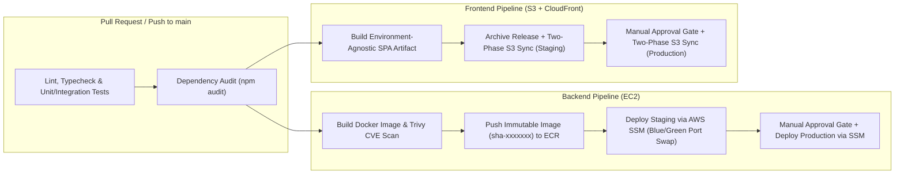

# Problem 4: Ship It Twice — Production-Ready CI/CD Pipelines

## 1. Overview & Deliverables

This directory contains production-ready CI/CD pipelines built with GitHub Actions for a two-tier web product:

* **Backend HTTP API (`EC2`):** [`.github/workflows/backend-cicd.yml`](.github/workflows/backend-cicd.yml) + [`scripts/deploy-ec2.sh`](scripts/deploy-ec2.sh)
* **Frontend Static SPA (`S3 + CloudFront`):** [`.github/workflows/frontend-cicd.yml`](.github/workflows/frontend-cicd.yml) + [`scripts/deploy-s3-frontend.sh`](scripts/deploy-s3-frontend.sh)

---

## 2. What "Production Ready" Means Here (Key Engineering Decisions)

Replacing manual releases with a basic `git pull` over SSH or a naive `aws s3 sync --delete` introduces severe production failure modes: dropped requests during process restarts, leaked long-lived AWS keys, and broken SPA lazy-loading (`ChunkLoadError`).

Below are the **6 architectural pillars** implemented in these workflows to make them truly production-grade:

### 2.1. Eliminating SPA White-Screen Errors via Two-Phase Atomic S3 Sync
* **The Common Pitfall:** Running a single `aws s3 sync dist/ s3://bucket --delete` uploads `index.html` alongside hashed chunks in arbitrary order while deleting the previous release's JS chunks (`chunk-old.js`). Users who already have the web app open in their browser tab and click a lazy-loaded route immediately hit `404 Not Found` (`ChunkLoadError`), resulting in a blank screen.
* **Our Implementation ([`scripts/deploy-s3-frontend.sh`](scripts/deploy-s3-frontend.sh)):**
  1. **Phase 1 (Hashed Assets First, No Delete):** Uploads all fingerprinted assets (`assets/*.js`, `*.css`, fonts, images) with `Cache-Control: public, max-age=31536000, immutable` **without `--delete`**. Active users on the previous `index.html` continue loading old chunks without interruption, while new chunks are pre-staged across S3 before any user references them.
  2. **Phase 2 (Entrypoints Last with No-Cache):** Generates the environment's runtime `/config.json` and uploads `index.html`, `config.json`, and `service-worker.js` last with `Cache-Control: no-cache, no-store, must-revalidate`.
  3. **Phase 3 (Targeted Edge Purge):** Invalidates only `/index.html`, `/config.json`, and `/service-worker.js` on CloudFront (`aws cloudfront create-invalidation`), minimizing CloudFront invalidation costs and completing atomic cutover in seconds.
  4. **Phase 4 (Safe Delayed Pruning of Unreferenced Assets):** Rather than using a naive S3 Lifecycle Expiration rule on the live bucket (which would delete *still-active* unchanged vendor/font chunks 30 days after their initial creation date!), Phase 4 queries `s3api list-objects-v2` and deletes only `assets/*` objects that are **both** absent from the current `${DIST_DIR}/assets/` manifest **and** older than a 7-day grace window.

### 2.2. True "Build Once, Promote Everywhere" (Even for Static SPAs)
* **The Common Pitfall:** Re-running `npm run build` separately for Staging (`.env.staging`) and Production (`.env.production`). This violates artifact immutability—the bundle deployed to Production is not the exact binary tested in Staging.
* **Our Implementation ([`.github/workflows/frontend-cicd.yml`](.github/workflows/frontend-cicd.yml)):**
  * The `quality-and-build` job compiles `dist/` **strictly once** and uploads `frontend-dist-<sha>` as an immutable artifact.
  * Environment-specific configuration (`apiBaseUrl`, `releaseSha`, `deployedAt`) is injected at deploy time into `/config.json`, which the SPA fetches on boot. Staging and Production execute the exact same compiled JS/CSS bytes.

### 2.3. Zero-SSH Network Posture & Local Blue/Green Cutover on EC2
* **The Common Pitfall:** Opening inbound TCP port `22` (SSH) to GitHub Actions runner IP ranges, storing private SSH keys in GitHub Secrets, and running `docker stop && docker run` or `pm2 restart` (which drops in-flight HTTP requests and causes 5–15 seconds of downtime—or a total outage if the new container crashes on boot).
* **Our Implementation ([`scripts/deploy-ec2.sh`](scripts/deploy-ec2.sh)):**
  * **Zero-SSH via AWS SSM Run Command (with `TargetCount > 0` Verification):** EC2 instances have no public SSH port open and require no bastion host. GitHub Actions dispatches commands over the AWS Systems Manager API (`aws ssm send-command`) targeting `tag:Role=backend-api-<env>` with `--max-concurrency 1` and `--max-errors 0` (rolling instance-by-instance safety), and explicitly verifies `TargetCount > 0` so a tag mismatch can never produce a silent false-positive deployment.
  * **In-Memory Secrets (`/dev/shm` Mount + Boot-Time Hydration Without `--env-file` Disk Leak):** On each EC2 instance, runtime secrets are pulled from **AWS SSM Parameter Store** (`--with-decryption --output json | jq`) directly into a RAM-backed `tmpfs` file (`/dev/shm/api-<slot>.env`, `chmod 0400`). Instead of passing `--env-file` to `docker run` (which causes the Docker daemon to persist plaintext environment variables onto the EBS root disk inside `/var/lib/docker/containers/<id>/config.v2.json`), the `tmpfs` file is bind-mounted read-only into the container (`-v /dev/shm/api-<slot>.env:/run/secrets/app.env:ro`) and sourced into `process.env` before `exec "$@"` invokes the image's native `ENTRYPOINT`/`CMD` inspected from the Dockerfile. To survive EC2 host reboots (`--restart unless-stopped`), a lightweight `api-shm-secrets.service` systemd unit (`Before=docker.service`) re-hydrates `/dev/shm/api-*.env` from SSM Parameter Store on boot before Docker starts containers.
  * **Blue/Green Port Switching Behind Local NGINX (NGINX Upstream as Source of Truth & Fleet-Once DB Migrations):**
    * The script inspects `/etc/nginx/conf.d/api-upstream.conf` as the authoritative source of truth to determine whether `api-blue` (`3001`) or `api-green` (`3002`) is currently serving live traffic, runs expand-only database migrations (`npm run migrate:up --if-present`) **strictly once per release** on the first rolling instance (tracking `_last_migrated_image` in SSM so instances `2..N` do not redundantly re-run migrations), and starts the new container on the inactive port.
    * It polls `http://127.0.0.1:3002/status` up to 20 times.
    * **Auto-Abort on Failure:** If the candidate container fails `/status`, the script prints the last 50 lines of container logs, removes the failed candidate container, leaves `api-blue:3001` serving 100% of traffic untouched, and aborts the rollout across remaining EC2 nodes (**0% user-facing impact on bad deploy**).
    * **Atomic Cutover & Graceful Drain:** Once `/status` passes, NGINX upstream is updated to `127.0.0.1:3002` and reloaded via `nginx -t && systemctl reload nginx` (zero dropped packets), followed by `docker stop --time 30` on the old slot so in-flight requests finish cleanly.

### 2.4. Supply-Chain Security & Least-Privilege AWS OIDC Roles
* **Zero Static AWS Keys:** Uses GitHub's OIDC provider (`id-token: write`) with `aws-actions/configure-aws-credentials@v4`.
* **Role Segregation (Blast-Radius Isolation):**
  * `AWS_OIDC_BUILD_ROLE_ARN`: Scoped strictly to push images to ECR.
  * `AWS_OIDC_STAGING_DEPLOY_ROLE_ARN` / `AWS_OIDC_STAGING_FRONTEND_ROLE_ARN`: Scoped only to Staging resources.
  * `AWS_OIDC_PROD_DEPLOY_ROLE_ARN` / `AWS_OIDC_PROD_FRONTEND_ROLE_ARN`: Trust policy restricts assumption to `repo:<org>/<repo>:environment:production`, meaning AWS IAM itself refuses the token unless GitHub's `production` Environment Protection rules (manual reviewer approval) have been satisfied.
* **Pre-Registry Vulnerability Gate:** The Docker image is built locally (`load: true`) and scanned with **Trivy** (`aquasecurity/trivy-action`, `severity: CRITICAL,HIGH`, `exit-code: 1`) *before* `docker/build-push-action` is allowed to push it to Amazon ECR. Vulnerable images never enter the registry.

### 2.5. Sub-Minute 1-Click Rollback Mechanisms
* Waiting 10 minutes for `git revert` + CI test + Docker build during a P1 production incident is unacceptable.
* **Backend Instant Rollback:** Trigger `backend-cicd.yml` via `workflow_dispatch` with `rollback_image_tag: sha-<previous>`. Both `lint-test-scan` and `build-and-publish` are bypassed via explicit job-level `if:` guards so a broken `main` branch test never blocks an emergency rollback, immediately running `deploy-ec2.sh` to swap EC2 containers back to the known-good ECR image tag.
* **Frontend Instant Rollback:** Every deployment archives a snapshot under `s3://<bucket>-releases/<sha>/`. Triggering `frontend-cicd.yml` with `rollback_release_sha: <previous-sha>` bypasses `quality-and-build`, syncs the archived bundle directly from S3-to-S3, and invalidates CloudFront in under 30 seconds.

### 2.6. Non-Destructive Deployment Concurrency (`cancel-in-progress: false`)
* Many pipelines mistakenly set `cancel-in-progress: true` globally. If applied to deployment jobs, merging two PRs in quick succession kills an active SSM command or S3 sync mid-flight, leaving infrastructure in a half-deployed state.
* Our deployment jobs enforce environment-scoped concurrency (`group: backend-deploy-production`, `cancel-in-progress: false`), queuing subsequent deployments cleanly behind the active rollout.

---

## 3. Assumptions Made & Why

| Assumption | Reasoning |
| :--- | :--- |
| **1. Monorepo structure (`/backend`, `/frontend`, `/scripts`)** | Since both applications belong to the same web product and repository, path filters (`paths: ["backend/**"]` and `paths: ["frontend/**"]`) isolate triggers so a frontend change does not redeploy the EC2 backend. |
| **2. Node.js 20 runtime for both Backend API and Frontend SPA build** | Standardizes toolchain caching (`actions/setup-node@v4` with `npm ci`) and matches the stack used across the challenge. |
| **3. Backend runs as a Docker container on EC2 behind local NGINX** | Running raw Node processes via PM2 directly on EC2 suffers from host Node version drift and dependency conflicts. Packaging the backend as an ECR container and running Blue/Green slots (`api-blue` on `3001`, `api-green` on `3002`) behind local NGINX provides container isolation and zero-downtime switching on a single EC2 host or across an Auto Scaling Group. |
| **4. CloudFront sits in front of the S3 Frontend bucket** | Serving a production SPA directly from an S3 website endpoint lacks HTTPS on custom domains, HTTP/2-3 compression, and edge caching. We assume **CloudFront with Origin Access Control (OAC)** fronts a private S3 bucket. |
| **5. Runtime secrets live in AWS SSM Parameter Store (`SecureString`)** | Storing application secrets (`DATABASE_URL`, API keys) inside GitHub Secrets scatters sensitive data across third-party CI systems. Instead, the EC2 instance profile fetches decrypted parameters from `/web-product/<env>/backend` into an in-memory `tmpfs` file (`/dev/shm/api-<slot>.env`) at startup. |
| **6. Staging -> Production promotion on `main` with GitHub Environment Protection** | Every push to `main` automatically deploys to `staging`. The `deploy-production` job is bound to the `production` GitHub Environment, which enforces required reviewers and wait timers before production rollout proceeds. |

---

## 4. End-to-End Pipeline Walkthrough

### A. Backend Pipeline ([`.github/workflows/backend-cicd.yml`](.github/workflows/backend-cicd.yml))

1. **`lint-test-scan` (CI Gate):**
   * Spins up an ephemeral PostgreSQL 15 service container with health checks (`pg_isready`).
   * Runs `npm ci`, `npm run lint`, `npm run typecheck`, `npm audit --omit=dev --audit-level=high`, and unit/integration tests (`npm test -- --coverage`).
2. **`build-and-publish` (Artifact Creation & Container Security):**
   * Assumes the `AWS_OIDC_BUILD_ROLE_ARN` IAM role via OIDC.
   * Builds the Docker image using Buildx layer caching (`type=gha`).
   * Scans the built image with **Trivy** for `HIGH` and `CRITICAL` OS and library vulnerabilities (`exit-code: 1` blocks pushing vulnerable images).
   * Pushes `sha-<7char>` to Amazon ECR.
3. **`deploy-staging` & `deploy-production` (Zero-Downtime EC2 Rollout via SSM):**
   * Invokes [`scripts/deploy-ec2.sh`](scripts/deploy-ec2.sh) to execute a rolling Blue/Green container switch over AWS SSM Run Command, followed by an external smoke test against `/status`.

### B. Frontend Pipeline ([`.github/workflows/frontend-cicd.yml`](.github/workflows/frontend-cicd.yml))

1. **`quality-and-build` (CI & Immutable Bundle):**
   * Runs `npm ci`, linting, typechecking, `npm audit`, and unit tests.
   * Compiles the production bundle (`npm run build`) and uploads `dist/` as a workflow artifact (`frontend-dist-<sha>`).
2. **`deploy-staging` & `deploy-production` (Two-Phase S3 Sync & CloudFront Invalidation):**
   * Invokes [`scripts/deploy-s3-frontend.sh`](scripts/deploy-s3-frontend.sh) to archive the release to `s3://<bucket>-releases/<sha>/`, execute the two-phase S3 upload, and invalidate CloudFront entrypoints.

---

## 5. What Was Deliberately Left Out & Trade-offs Accepted

To keep the pipelines fast (< 5 minutes end-to-end), maintainable, and proportional to a small two-application team, the following were deliberately excluded:

1. **No Immediate `--delete` During Phase 1 S3 Sync (Replaced by Phase 4 Grace-Window Pruning):**
   * *Why:* Running `aws s3 sync --delete` immediately deletes old hashed JS chunks (`chunk-old.js`) while clients with open browser tabs still reference them, and a naive 30-day S3 Lifecycle rule on the live bucket would delete unchanged active vendor chunks 30 days after their first creation. Instead, Phase 4 prunes only `assets/*` objects that are both absent from the current release manifest and older than 7 days, while the separate `s3://<bucket>-releases/` archive bucket uses a 30-day S3 Lifecycle expiration policy.
2. **No Full Browser E2E Suite (Playwright/Cypress) Blocking Every Push:**
   * *Why:* Full browser E2E suites add 10–15 minutes of execution time and introduce flakiness that slows down hotfixes. Instead, we run fast unit/integration tests against an ephemeral Postgres container pre-merge, plus deterministic `/status` smoke checks post-deploy.
3. **No Golden AMI Packer Pipeline (Packer + ASG Instance Refresh):**
   * *Why:* Baking a new AMI with Packer and cycling EC2 instances takes 12–20 minutes per release. Deploying immutable Docker containers via SSM Run Command with local Blue/Green NGINX port switching achieves the same immutability and zero-downtime cutover in ~25 seconds without adding third-party agent overhead (SSM Agent is pre-installed on Ubuntu/Amazon Linux AMIs).
4. **No Multi-Region Active-Active Replication in CI/CD:**
   * *Why:* The product is a standard single-region deployment (`ap-southeast-1`) fronted by CloudFront. Multi-region orchestration adds state synchronization complexity without business justification at this stage.
