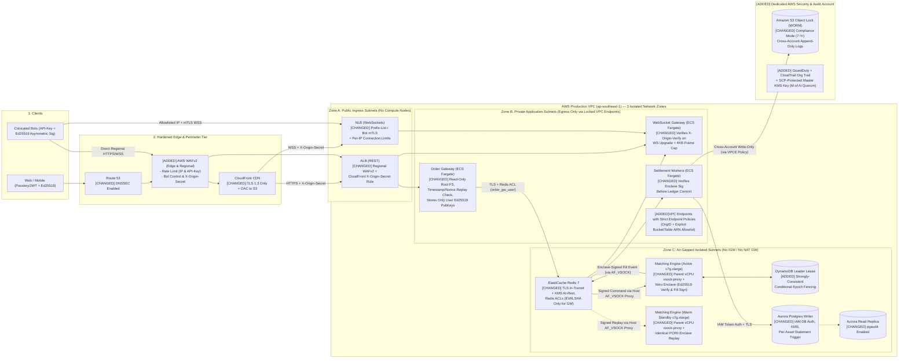

# Problem 5: Fortify The Castle — Security-Integrated Trading Architecture

## 1. Security Philosophy & Threat Model for a 500 RPS (`p99 < 100ms`) Exchange

Securing a financial exchange is fundamentally different from securing a standard web application:
1. **The Adversary Model:** Attackers are not just trying to deface a page or scrape emails—they aim to **inflate account balances (double-spend / race conditions)**, **manipulate the Order Book (spoofing / replay attacks)**, **exfiltrate signing keys**, or **launch Layer-7 DDoS attacks during market volatility to liquidate competitors**.
2. **The Latency Constraint (`p99 < 100ms`):** In **Problem 1**, our Hot Path achieved **`p99 = 20.01ms` at 500 RPS** (`26.11ms` at 2,500 RPS burst). Every security control added to the synchronous Hot Path must be accounted for in milliseconds. If we naively insert heavyweight external KMS round-trips (`~15–25ms` each) or deep regex payload inspection on every hop, we break the SLA.

Therefore, our security architecture follows three core principles:
* **Cryptographic Integrity on the Hot Path (< 2.5ms total overhead):** Use local CPU-accelerated cryptography (`Ed25519`/`HMAC-SHA256`) and keyed hash chains (`prev_hash` + `event_hmac`) inside Redis Streams and Aurora so a compromised internal container still cannot forge a balance credit.
* **Zero-Trust Network Isolation (Air-Gapped Subnet Tiers):** The Matching Engine and Financial Ledger live in **Isolated Subnets (`0.0.0.0/0` route does not exist—no NAT Gateway, no Internet Gateway)**, reachable only from specific upstream Security Groups.
* **Blast-Radius Segregation:** Separate AWS Accounts for **Production Workload**, **Security / Immutable Audit Archive**, and **CI/CD Control Plane**.

---

## 2. Unknown Facts, How We Would Obtain Them & Working Assumptions

The prompt asks: *"Where you need facts you do not have, say what you would need, how you would get it, and what you assumed in the meantime."*

| Missing Fact / Question | How We Would Obtain It in Practice | Assumption Made for This Design |
| :--- | :--- | :--- |
| **1. Custody Model:** Does this system directly hold on-chain crypto private keys (Hot/Cold Wallets) or is custody handled by an external provider (e.g., Fireblocks) / fiat banking rail? | Interview the Product & Custody Engineering leads; inspect the deposit/withdrawal service specifications. | **Assumed:** On-chain private keys are isolated in an external MPC/HSM custody enclave (**AWS Nitro Enclaves + KMS**), while the core exchange in Problem 1 manages the **internal off-chain Omnibus Ledger & Order Matching**. |
| **2. Regulatory & Compliance Jurisdiction:** Are we subject to MAS (Singapore), VARA (Dubai), SOC 2 Type II, ISO 27001, or PCI-DSS? | Consult Legal/Compliance and review the target licensing requirements (e.g., MAS Technology Risk Management guidelines). | **Assumed:** Operating out of Singapore (`ap-southeast-1`) requiring **MAS TRM / SOC 2 Type II** controls: 7-year immutable audit retention, customer PII encryption, and strict role segregation. |
| **3. Bot vs. Retail Traffic Ratio & Geographic Footprint:** What percentage of the 500 RPS comes from institutional market-maker bots (static IPs) vs. retail browsers/mobile apps? | Analyze 30 days of historical CloudFront/ALB access logs and User-Agent / API-Key distributions. | **Assumed:** 70% API trading bots (authenticated via `API-Key` + `Ed25519/HMAC` request signing) and 30% retail Web/Mobile users (authenticated via short-lived OAuth2/WebAuthn JWTs). |
| **4. Internal Team Structure & Access Needs:** Who needs production database access (e.g., Customer Support, Finance Reconciliation, DevOps on-call)? | Conduct an IAM access review with Engineering and Operations leads. | **Assumed:** **Zero human SSH/SQL write access** in production. Support and Finance read via a dedicated internal read-only portal backed by the Aurora Read Replica; emergency break-glass access requires 2-person approval. |

---

## 3. Updated Architecture Diagram (With Security Changes Marked)

Every modification to the **Problem 1** architecture is explicitly marked in the diagram and detailed in Section 4:
* **`[ADDED]`** — New security component or boundary introduced into the architecture.
* **`[CHANGED]`** — Existing Problem 1 component re-architected or hardened.
* **`[ACCEPTED RISK]`** — Deliberate architectural decision where a heavier control was omitted/simplified to preserve `p99 < 100ms` and cost efficiency.

---

## 4. Detailed Breakdown of Architectural Changes (`[CHANGED]` & `[ADDED]`)

### 4.1. Edge & Ingress Hardening (Protecting Availability & Preventing Origin/WAF Bypass)
| Modification | Type | Why It Is There & What Threat It Protects Against | Latency Impact |
| :--- | :--- | :--- | :--- |
| **AWS WAFv2 (At CloudFront Edge & Regional ALB) with API-Key Rate Limiting** | `[ADDED]` | **Threat:** Layer-7 DDoS, credential stuffing, and runaway trading bots flooding `/api/v1/order` to exhaust gateway CPU or starve other traders during market crashes. **Defense:** Enforces rate-based rules per IP (`300 req/min` for unauthenticated endpoints) and per `X-MBX-APIKEY` header (`50 orders/10s`) both at CloudFront (for global retail traffic) and via Regional WAFv2 on the ALB (for co-located trading bots in `ap-southeast-1`). | `+0.8 ms` |
| **CloudFront-to-ALB/NLB Origin Cloaking (`X-Origin-Verify` + Rogue-Distribution Protection)** | `[CHANGED]` | **Threat:** Attackers discovering the ALB/NLB public IP/DNS to bypass WAF directly—or spinning up their own rogue AWS CloudFront distribution pointing at the NLB to bypass our CloudFront Prefix List Security Group. **Defense:** ALB listener rules drop any CloudFront request missing a rotated secret header (`X-Origin-Verify`). Because **NLB operates at Layer 4** and cannot inspect HTTP headers (meaning a prefix-list SG alone could be bypassed by an attacker's own CloudFront distribution), the **WebSocket Gateway (`WsGW`) explicitly verifies `X-Origin-Verify` during the HTTP `Upgrade: websocket` handshake** (or mTLS client certs for direct institutional bots) and immediately terminates unauthorized sockets. | `0.0 ms` |
| **Asymmetric `Ed25519` Request Signing & Anti-Replay Window** | `[CHANGED]` | **Threat:** Man-in-the-Middle (MitM), replay of a captured `POST /api/v1/order` packet, or **compromised Order Gateway forging user orders**. **Defense:** Every mutating API request requires an asymmetric **`Ed25519`** signature over `verb + path + timestamp + recvWindow + nonce + body`. Crucially, the exchange stores **only the user's `Ed25519` Public Key** (never a shared symmetric secret), and the signature is verified both at the Order Gateway and inside the Matching Engine's Nitro Enclave. The Order Gateway also rejects any request where `abs(now - timestamp) > 5000ms` or where `nonce` exists in Redis (`reserve_and_enqueue.lua`). | `+0.3 ms` |

### 4.2. VPC Network Topology Redesign (3-Zone Segmentation with Exfiltration-Proof VPC Endpoint Policies)
In **Problem 1**, all backend services were depicted inside a single logical VPC block. In **Problem 5**, we re-architect the VPC into **three strictly segregated subnet tiers**:
1. **Zone A — Public Ingress Subnets (`10.0.0.0/22`):** Contains **only** the ALB and NLB. Zero EC2/ECS compute tasks live here.
2. **Zone B — Private Application Subnets (`10.0.4.0/22`):** Hosts the stateless **Order Gateway**, **WebSocket Gateway**, and **Settlement Workers**. Has **no Internet Gateway route**; external AWS API calls traverse **AWS PrivateLink Interface VPC Endpoints** inside the VPC.
3. **Zone C — Air-Gapped Isolated Subnets (`10.0.8.0/22`):** Hosts **ElastiCache Redis**, **Matching Engine EC2 (`c7g.xlarge` — upgraded from `c7g.large` to 4 vCPUs / 8 GB RAM because AWS Nitro Enclaves require at least 4 vCPUs on the parent instance so 2 dedicated cores can be carved out for the Enclave while leaving 2 vCPUs for the parent host)**, and **Aurora PostgreSQL**.
   * **Routing & Anti-Exfiltration VPC Endpoint Policies:** `Zone C` has **zero route to `0.0.0.0/0` (no NAT Gateway, no IGW)**. It communicates only within `10.0.0.0/16` (including Interface VPC Endpoints for `kms` and `ssm`) and Gateway VPC Endpoints (`s3`, `dynamodb`) for 60s Order Book snapshots and DynamoDB `leader_epoch` leases.
   * **Closing the VPC Endpoint Exfiltration Loophole:** By default, an unrestricted S3 or DynamoDB VPC Endpoint allows traffic to *any* S3 bucket in AWS (allowing an attacker with RCE to run `aws s3 cp` to their own external S3 bucket). We attach a strict **VPC Endpoint Policy** enforcing `aws:ResourceAccount` / `aws:PrincipalOrgID` and allowlisting **only** the exact ARNs of the production snapshot/WORM buckets and `exchange_leader_lease` table—making external data exfiltration via VPC Endpoints impossible.

### 4.3. Hot Trading Core & Ledger Integrity (Preventing Internal Tampering & Balance Inflation)
The most catastrophic risk in an exchange is an insider threat or a compromised container directly running `HSET user:123:balance USDT 99999999` in Redis or `UPDATE balances SET available = 99999999` in PostgreSQL. We re-engineered the data flow to make unauthorized balance inflation mathematically and operationally impossible:

1. **`[CHANGED]` Least-Privilege Redis 7 ACLs & Command Renaming:**
   * Instead of a shared default Redis password, we configure **Redis 7 Access Control Lists (ACLs)**:
     * `order_gw_user`: Allowed **only** to execute `EVALSHA` (the pre-loaded atomic `reserve_and_enqueue.lua` script) and `SUBSCRIBE` on `gw:reply:*`. It **cannot** run raw `HSET`, `SET`, `DEL`, `FLUSHALL`, `CONFIG`, or `KEYS`.
     * `matching_engine_user`: Allowed **only** to `XREADGROUP` from `stream:orders`, execute `EVALSHA` (`apply_match_result.lua`), `WAIT`, and `PUBLISH` to `gw:reply:*` / `md:*`.
     * `ws_gw_user`: Strictly **read-only** (`SUBSCRIBE` / `ZRANGE` on public order book keys); zero access to `user:*` balance hashes.
2. **`[ADDED]` End-to-End `Ed25519` Verification, Attested Public-Key Binding, Canonical Hash-Chaining & KMS PCR0 Attestation:**
   * **Why a Compromised Order Gateway Cannot Forge Orders or Spoof User Public Keys:** Because users sign orders with asymmetric **`Ed25519` private keys** and the exchange only stores their public keys, even if an attacker compromises an **Order Gateway** container and steals its internal `gw_hmac` key, they **cannot forge a valid `client_ed25519_sig`** for any user. Furthermore, to prevent a compromised Order Gateway or Redis instance from swapping a victim's `user_id -> ed25519_pubkey` mapping, every registered user API key is bound by a **KMS-signed Key Certificate** (`kms_sig(user_id, ed25519_pubkey, key_version)`) issued during Passkey/WebAuthn MFA registration. The Nitro Enclave embeds the immutable Security Account KMS Public Key inside its attested `.eif` image (`PCR0`) and verifies `kms_sig(user_id, ed25519_pubkey)` before caching the user's public key in Enclave RAM—making key-substitution attacks impossible.
   * **Canonical Deterministic Hash Chain Across Failover & Local `AF_VSOCK` Bridge:** Because AWS Nitro Enclaves have no external TCP/IP network interface by design, a lightweight parent forwarder (`vsock-proxy`) running on the 2 host vCPUs of `c7g.xlarge` bridges the Redis Stream (`XREADGROUP` / `EVALSHA`) and DynamoDB lease checks over a local in-memory `AF_VSOCK` channel into the 2 dedicated Enclave vCPUs (`< 0.3ms` IPC overhead). When the **Matching Engine (`c7g.xlarge` — upgraded from Problem 1's `c7g.large` to meet AWS Nitro Enclaves' 4-vCPU minimum hardware requirement, adding ~$105/month across Active + Warm Standby)** inside its **AWS Nitro Enclave** verifies `client_ed25519_sig` and produces an `OrderFilled` event, it computes a deterministic state hash:
     $$\text{fill\_hash}_{n} = \text{SHA256}(\text{fill\_hash}_{n-1} \parallel \text{seq\_id}_{n} \parallel \text{canonical\_fill\_payload}_{n})$$
     Crucially, `fill_hash` depends **only** on the deterministic order sequence and canonical fill data (excluding `leader_epoch` or wall-clock timestamps from the inner hash), and the Enclave then signs `(leader_epoch, seq_id, fill_hash)` using its attested private key. Because both Active and Warm-Standby replay the exact same `seq_id` stream, the Warm Standby's in-memory `fill_hash` is 100% identical to the Active node's at every `seq_id`, guaranteeing zero hash-chain forks when failing over to `leader_epoch + 1`.
   * **Cross-Account KMS Key Governance & M-of-N PCR0 Quorum:** Both Active and Warm-Standby Enclaves are built from the same reproducible Enclave Image File (`.eif`). The Master KMS Key lives in the **Dedicated Security Account** and restricts `kms:Decrypt` via `kms:RecipientAttestation:ImageSha384 == <PCR0_HASH>`. An **AWS Organizations Service Control Policy (SCP)** blocks `kms:PutKeyPolicy` and `kms:ScheduleKeyDeletion` unless approved by an **M-of-N multi-party quorum**, preventing a compromised CI/CD role or rogue admin from substituting a backdoored `<PCR0_HASH>`.
   * Before the **Settlement Worker** commits a balance credit to **Aurora PostgreSQL**, it verifies the Matching Engine's enclave signature, the active `leader_epoch`, and the monotonic `seq_id`.
3. **`[CHANGED]` Immutable Double-Entry Ledger Enforcement in Aurora PostgreSQL (Per-Asset Statement Trigger with Fee-Treasury Legs):**
   * **IAM Database Authentication (with Pooled Background Refresh):** Settlement Workers authenticate to Aurora using short-lived (15-minute) **RDS IAM tokens** instead of static database passwords, rotating tokens asynchronously in the connection pool background (staying well under RDS IAM's 200 new connections/sec limit).
   * **Append-Only Permissions & Per-Asset Statement-Level Transition Table Trigger:** The `settlement_worker` PostgreSQL role is granted `INSERT, SELECT` on `ledger_entries` (and **explicitly denied `UPDATE, DELETE, TRUNCATE`**). Every matched trade explicitly records **all 6 double-entry journal legs**—debiting the gross amount from Buyer (`USDT`) and Seller (`BTC`), crediting the net proceeds (`gross - fee`) to Seller (`USDT`) and Buyer (`BTC`), and crediting the exact Maker/Taker fees (`fee_USDT`, `fee_BTC`) to the `exchange_fee_treasury` account. Rather than using a `FOR EACH ROW` constraint trigger (which would fire hundreds of times per batch and risk cross-asset inflation if not grouped by currency), we use a PostgreSQL **Statement-Level Trigger with Transition Tables (`AFTER INSERT ON ledger_entries REFERENCING NEW TABLE AS new_rows FOR EACH STATEMENT`)** that executes **strictly once per `20ms` micro-batch `INSERT`** over only the newly inserted rows in RAM and enforces the zero-sum accounting invariant **grouped by each individual asset (`GROUP BY asset`)**:
     $$\forall \text{asset} \in \{\text{BTC}, \text{ETH}, \text{USDT}, \dots\}: \quad \sum_{\text{new\_rows, asset}} \text{Debits} - \sum_{\text{new\_rows, asset}} \left(\text{Credits}_{\text{traders}} + \text{Credits}_{\text{fee\_treasury}}\right) = 0$$
     This guarantees that `Debits` equal `Credits` down to the 18th decimal place (`NUMERIC(36,18)`) even when trading fees are deducted, mathematically preventing both unbacked currency creation and cross-asset substitution attacks (e.g., debiting `100 USDT` to credit `100 BTC`).

### 4.4. Multi-Account Immutable Audit Trail (`S3 Object Lock WORM`)
* **`[CHANGED]` Cross-Account Write-Only Audit Archive:**
  * In Problem 1, audit logs were written to an S3 bucket in the same AWS account. If an attacker compromised the Production AWS Account root/admin role, they could delete the S3 bucket to cover their tracks.
  * In Problem 5, `OrderFilled` logs, CloudTrail management/data events, VPC Flow Logs, and `pgaudit` logs are streamed one-way into a **separate AWS Security & Log Archive Account** into an S3 bucket configured with **S3 Object Lock in `COMPLIANCE` mode (Write-Once-Read-Many / WORM)**. Not even the root user of the AWS account can delete or overwrite those logs before the retention period expires.

---

## 5. Verification of the `p99 < 100ms` SLA After Security Hardening

Did our security changes break Problem 1's `< 100ms` latency requirement? Let us update our **M/M/1 Queueing Theory Latency Budget** from Problem 1 (`20.01ms` at 500 RPS, `26.11ms` at 2,500 RPS burst):

| Security Control Added to Hot Path | Added Latency (`p99`) | Why It Stays Fast |
| :--- | :--- | :--- |
| **Baseline Problem 1 Hot Path `p99`** | **`20.01 ms`** (at 500 RPS) | From Problem 1 Section 2.3 mathematical proof. |
| **1. AWS WAFv2 Inspection at CloudFront Edge** | **`+0.80 ms`** | Evaluated in memory at the CloudFront PoP during TLS termination. |
| **2. Request Signature (`Ed25519`/`HMAC`) + Nonce Replay Check** | **`+0.35 ms`** | Computed on Graviton3 hardware crypto instructions; nonce check Piggybacks on the existing Redis Lua `EVALSHA` call (`0` extra network RTTs!). |
| **3. In-Transit TLS 1.3 (`OrderGW <-> Redis <-> Matching Engine`)** | **`+0.40 ms`** | Uses persistent connection pooling (`keepalive`); TLS handshake occurs once at container boot, leaving only `AES-GCM` hardware-accelerated symmetric framing (`< 0.1ms` per hop). |
| **4. Nitro Enclave Fill Signing (`vsock` local IPC)** | **`+0.30 ms`** | Communicates over local in-memory `AF_VSOCK` between the 2 parent vCPUs and 2 dedicated Enclave vCPUs on the same `c7g.xlarge` instance without network traversal. |
| **Hardened End-to-End `p99` Total** | **`21.86 ms` (at 500 RPS)** **`28.40 ms` (at 2,500 RPS)** | **Only `+1.85 ms` total security overhead — still `> 71 ms` faster than the `100ms` p99 ceiling!** |

---

## 6. Prioritization Framework: What We Secure First, Defer, and Refuse to Ship Without

### 6.1. Tier 0 — "Refuse to Ship Without" (Launch Blockers / Day 0)
We would **block production launch** if any of the following controls were missing, because a failure here results in irreversible loss of customer funds or total exchange insolvency:
1. **Atomic Pre-Trade Balance Reservation + Double-Entry Ledger Invariant ($\sum \text{Debits} = \sum \text{Credits}$):** Without atomic Lua locking and append-only double-entry verification, a single race-condition exploit allows an attacker to withdraw or trade 10x their actual balance within seconds.
2. **Air-Gapped Isolated Subnets (`Zone C`) for Matching Engine, Redis, and Aurora:** Stateful financial stores must never have a route to `0.0.0.0/0` or public IP addresses.
3. **Cryptographic API Request Signing + Timestamp/Nonce Anti-Replay Window:** Prevents unauthorized order injection and replay attacks.
4. **CloudFront + AWS WAF Rate Limiting + Origin Cloaking:** Without L7 rate limiting and origin protection, a $50 botnet flood can knock the exchange offline during a market crash.
5. **Least-Privilege IAM & Redis ACLs + Zero Static Credentials (IMDSv2 `HttpPutResponseHopLimit = 1`):** Prevents SSRF or a compromised stateless gateway from dumping credentials or wiping Redis.
6. **Cross-Account WORM Audit Logging (`S3 Object Lock`):** Mandatory for post-incident forensics and financial reconciliation if a dispute or breach occurs.

### 6.2. Tier 1 — "Secure Next" (Days 1–30 Post-Launch)
Important defense-in-depth and detection controls that do not block initial 500 RPS launch once Tier 0 is in place:
1. **Automated Runtime Threat Detection (`Amazon GuardDuty` + `ECS Runtime Monitoring`):** Detects anomalous container behavior (e.g., unexpected binary execution or crypto-mining inside a Fargate task) and triggers EventBridge automated quarantine alerts.
2. **Automated Withdrawal / Trading Anomaly Circuit Breakers:** An asynchronous risk worker watching the fills stream that automatically pauses a user account (or halts a trading pair) if price deviates by `> 15%` in 10 seconds or if a wash-trading pattern is detected.
3. **Database Activity Monitoring (`pgaudit` -> Security Account) & Automated Break-Glass Access Workflows (`AWS IAM Identity Center` temporary elevation).**

### 6.3. Tier 2 — "Deliberately Deferred" (When Scaling Past 5,000+ RPS)
Controls we **consciously postpone** at 500 RPS because their operational complexity, latency penalty, or cost outweighs their risk reduction today:
1. **Dedicated AWS Shield Advanced ($3,000/month fee):**
   * *Why Deferred:* At ~$1,695/month total infrastructure cost, paying $3,000/month for Shield Advanced nearly triples the budget. CloudFront + Shield Standard + WAFv2 rate-based rules already absorb volumetric L3/L4 and common L7 floods at a fraction of the cost.
2. **Sidecar Service Mesh for Internal mTLS (e.g., Istio / Envoy Sidecars on every ECS task):**
   * *Why Deferred:* Envoy sidecars add `2–5ms` of proxy serialization latency per hop and consume ~25% extra vCPU/RAM. Instead, we use native TLS 1.3 on persistent connections + AWS Security Group identity referencing (`sg-order-gw` -> `sg-redis`), achieving encryption in transit and strict network identity without sidecar bloat.
3. **Self-Hosted Enterprise SIEM / SOAR Cluster (e.g., Splunk / Elastic Security Cluster):**
   * *Why Deferred:* Running a dedicated SIEM cluster costs more than the exchange itself. At 500 RPS, **Amazon Athena** querying the immutable S3 Audit Archive + **GuardDuty** + **CloudWatch Alarms** provides full queryability at `< $50/month`.

---

## 7. What We Deliberately Left Out & Trade-Offs Accepted (`[ACCEPTED RISK]`)

1. **`[ACCEPTED RISK]` No Per-Order Synchronous KMS Network Call on the Hot Path:**
   * *Trade-off:* Calling the AWS KMS API (`kms:Sign` / `kms:Decrypt`) over the network on every single order (`500 RPS`) would add `10–25ms` of tail latency per call and cost ~$4,000+/month in KMS API charges, threatening the `p99 < 100ms` SLA.
   * *How We Mitigated It:* We use **AWS KMS Envelope Encryption**—data keys are decrypted once at container/enclave boot into locked memory (`mlock`), and all per-order HMAC/Ed25519 operations happen locally in CPU registers (`< 0.05ms`).
2. **`[ACCEPTED RISK]` Public Market Data WebSocket Streams (`@depth`, `@trade`) Are Unauthenticated at the Application Layer:**
   * *Trade-off:* Requiring JWT/HMAC signature verification on every public price-tick subscription increases CPU load on the WebSocket Gateway and hurts onboarding UX for anonymous visitors viewing the exchange homepage.
   * *How We Mitigated It:* The initial `Upgrade: websocket` handshake passes through **CloudFront + AWS WAFv2**; the **WebSocket Gateway (`WsGW`)** enforces a strict L7 frame cap (`maxPayload: 4KB`, `max 10 subscribe frames/sec` per socket) and uses a restricted read-only Redis ACL user (`ws_gw_user`) that has **zero read/write access to private user balances or orders**; and the NLB enforces per-IP connection limits.
3. **`[ACCEPTED RISK]` Asynchronous Settlement Delay (`~20ms` Window Between Redis Match and Aurora Commit):**
   * *Trade-off:* Moving Aurora PostgreSQL off the synchronous Hot Path means there is a `20ms` window where a trade is matched in Redis/Matching Engine before it is committed to the SQL ledger.
   * *How We Mitigated It:* The signed event is synchronously replicated in memory across 2 AZs (`Redis WAIT 1 50`) before returning `200 OK` to the trader. Even if a Settlement Worker crashes mid-batch, the replacement worker replays the unacknowledged events from the Redis Stream consumer group (`XREADGROUP`) using idempotent `(leader_epoch, seq_id)` keys, guaranteeing **eventual consistency within milliseconds and `RPO = 0`**.
